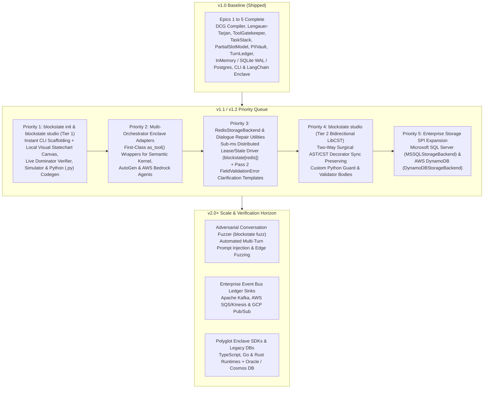

# Blockstate (`blockstate`): Product & Engineering Roadmap

> **Document Version**: 1.1 (30 October 2026)
> **Baseline Status**: `v1.0.0` Core Complete (Epics 1 to 5, Stories 1 to 10, 100% Patent Invariant Pass)
> **Patent Baseline**: UK Patent Pending (*Process execution control system*, Priority Filing Date: 28 October 2026, [`PATENTS.md`](../PATENTS.md))

---

## 1. Strategic Prioritisation Principles

Every post-`v1.0` engineering milestone is ranked by three strict criteria:

1. **Preservation of Independent Claim 1:** Every new tool or visual workflow feature must preserve canonical Python AST compilation (`ast.parse`, `[Blockstate E014]`), directed CFG BFS reachability (`BLK-AST-002`), Lengauer-Tarjan dominator tree verification (`LengauerTarjanSolver`), and stage-scoped `types.MappingProxyType` tool gatekeeping (`BLK-SEC-001`).
2. **Developer Velocity & Enterprise Governance:** Blockstate is designed for both **Python Systems Engineers** and **Model Risk Management (MRM) / CISO Reviewers**. Features that simultaneously accelerate **60-second developer activation** and **visual MRM/CISO compliance sign-off** take top priority.
3. **Production Deployment Readiness:** Features required for multi-orchestrator enterprise integrations (`LangGraph`, `Semantic Kernel`, `AutoGen`, `AWS Bedrock`) and distributed high-throughput storage backends are sequenced ahead of long-horizon R&D.

---

## 2. Shipped Baseline: `v1.0.0` (Complete)

All 24 capabilities in [`SPEC.md`](spec/SPEC.md) are live and verified across the test suite:
- **Compile-Time Verification (`blockstate.compiler`):** Zero-execution `ast.parse` DCG compiler (`[Blockstate E014]`), BFS reachability (`BLK-AST-002`), Lengauer-Tarjan dominator solver (`<50ms` for 500 nodes) with BFS counterexample bypass synthesis, and JSON/Mermaid exporters.
- **Zero-Trust Runtime (`blockstate.core`):** Stage-scoped `MappingProxyType` dispatch table and outbound schema filtering (`ToolGatekeeper`, `BLK-SEC-001`), bounded LIFO `TaskStack` (`max_stack_depth=6`, `BLK-SEC-003`), recursive `PartialSlotModel` $\Delta$-hydration (`max_nesting_depth=8`, `UNSET` sentinel, `locked_slots`, volatile `Vaulted[T]` validator detokenisation, `on_breach`).
- **Cryptographic Privacy & Audit (`blockstate.security`, `blockstate.adapters.ledger`):** Luhn Mod-10 and NHS Modulus-11 `PIIVault` with HMAC-SHA256 deduplication and AES-256-GCM `session_id:schema_version:revision_id` AAD binding; RFC 8785 JCS SHA-256 hash-chained `TurnLedgerRecord` with `SessionPartitionedRingBuffer` and `.blockstate/wal/ledger.wal` recovery across File, PostgreSQL, and S3 WORM sinks.
- **v1 Storage & Model Adapters (`blockstate.adapters`):** `InMemoryStorageBackend`, `SQLiteStorageBackend` (`PRAGMA journal_mode=WAL`), and `PostgresStorageBackend` (`SQLAlchemy[asyncio]` + `asyncpg`) with fenced leases (`BLK-CON-409`), heartbeats, CAS (`BLK-STO-002`), and `SchemaUpcaster`; `ONNXIntentClassifier`, `PydanticAIAdapter`, and `LiteLLMAdapter`.
- **Developer Surface (`blockstate.cli`, `blockstate.adapters.langchain`):** `blockstate check | verify | export | trace`, OpenTelemetry GenAI 1.30 spans, `as_tool()` enclave wrapper, and 5 runnable domain examples (`examples/01..05`).

---

## 3. Prioritised Post-`v1.0` Feature Backlog

### Priority 1 (`v1.1` Shipped): `blockstate studio` (Tier 1 Visual Canvas $\rightarrow$ `.py` Codegen & Live Dominator Inspector) + `blockstate init` CLI Scaffolder
- **Release Status:** Shipped in `v1.1`.
- **Why It Is #1 Priority:**
  1. **Sub-60-Second Developer Activation:** Running `blockstate init --template [banking|insurance|healthcare]` and `blockstate studio agent.py` gives developers an immediate visual statechart and working enclave without boilerplate setup.
  2. **Bridges Engineers and Governance Reviewers:** Engineers write Python; Model Risk Management (MRM) officers and CISOs review visual control flows and compliance proofs. `blockstate studio` lets both roles inspect the exact same Python source file visually, test Lengauer-Tarjan dominance rules (`step_up_mfa_kyc -> [faster_payments_uk, sepa_euro_transfer, swift_international]`) with live green/red path overlays, step through a live multi-turn `TaskStack` / `PIIVault` simulator, and export a formatted MRM Audit Certificate.
  3. **Code-First Python `.py` Generation (Preserves Patent Claim 1):** Unlike visual builders that store workflows as proprietary JSON blobs bypassing Python AST compilation, `blockstate studio` is a **visual topology architect and deterministic Python code generator**. Users can visually add `@Stage` nodes, configure Pydantic `BaseModel` slots (`Vaulted[T]`), tick stage `tools`, wire `@Transition` / `allow_digressions` / fallback edges, verify dominance in real time (`<5ms`), and emit a clean, PEP 695 type-annotated `.py` file that compiles via `ast_extractor.py`.
- **Scope (`v1.1`):**
  - `blockstate init [DIRECTORY] --template [banking|insurance|healthcare|minimal]`: Scaffolds a ready-to-verify agent file, test suite, `.env.example`, and GitHub Action (`blockstate-verify-pr.yml`).
  - `blockstate studio [PATH] [--port 8420]`: Zero-external-dependency local web server (stdlib/ASGI + static single-bundle HTML/CSS/JS UI) providing:
    - **Visual Statechart Canvas:** Renders any `.py` agent via `extract_statechart_from_source()` and `export_json()`, plus drag-and-drop creation of `@Stage` nodes, tool whitelists, Pydantic slot schemas, and transition edges.
    - **Live Lengauer-Tarjan Dominator Verifier:** Interactive precursor/target selector that runs `verify_dominance()` in `<5ms` on every edge change, highlighting dominated paths in green and synthesising BFS bypass counterexample paths in red.
    - **Deterministic Python (`.py`) Codegen Engine (`blockstate.compiler.codegen`):** Generates clean, valid Python 3.12+ DCG source code (`@Stage`, `@Transition`, `@Guard`, `BaseModel`) that passes `blockstate check`, `ruff`, and `mypy --strict` out of the box.
    - **Live Turn & `TaskStack` Trace Inspector:** Visualises `.blockstate/traces.jsonl` and interactive test turns showing `MappingProxyType` tool gating, `TaskStack` push/pop frames, $\Delta$-hydration locking, `<VAULT:...>` tokenisation, and SHA-256 `TurnLedger` verification.

---

### Priority 2 (`v1.1`): Multi-Orchestrator `as_tool()` Enclave Adapters (Semantic Kernel, AutoGen, AWS Bedrock)
- **Target Release:** `v1.1` minor release.
- **Why It Is #2 Priority:** Supports enterprise teams operating **Microsoft Semantic Kernel**, **AutoGen**, and **AWS Bedrock Agents** alongside **LangGraph** without requiring full-stack rewrites.
- **Scope (`v1.1`):**
  - `blockstate.adapters.semantic_kernel`: First-class `@kernel_function` / plugin wrapper around `BlockstateEnclaveTool` preserving the 3-state discriminated wire union (`BlockstateTurnYield | BlockstateTurnComplete | BlockstateTurnAborted`).
  - `blockstate.adapters.autogen`: First-class `FunctionTool` / `register_for_execution` enclave adapter for AutoGen v0.4+.
  - `blockstate.adapters.bedrock`: AWS Bedrock Action Group OpenAPI schema generator and Lambda handler wrapper for Blockstate enclaves.
  - Contract tests confirming 100% Claim 15 wire-boundary isolation across all four outer orchestrators.

---

### Priority 3 (`v1.2`): `RedisStorageBackend` (`blockstate[redis]`) & Built-In Pass 2 Dialogue Repair Utilities
- **Target Release:** `v1.2`.
- **Why It Is #3 Priority:** High-throughput FinTech and Telco environments frequently standardise on Redis for sub-millisecond distributed session locks and ephemeral checkpointing. Simultaneously, built-in dialogue repair templates eliminate boilerplate when rendering sanitised `FieldValidationError` prompts in Pass 2.
- **Scope (`v1.2`):**
  - `blockstate.adapters.storage.redis` (`RedisStorageBackend` via `redis.asyncio`, MIT licence): Atomic Lua-scripted `acquire_lease` fencing (`fence_token`, `BLK-CON-409`), `renew_lease` heartbeat, TTL expiry, and optimistic CAS (`revision_id`, `BLK-STO-002`), passing 100% of `StorageBackendContractSuite`.
  - `blockstate.core.repair`: Deterministic and LLM-assisted Pass 2 clarification prompt builders that consume sanitised `FieldValidationError` lists (`BLK-VAL-002`) and missing $\Delta$ leaf descriptions without exposing raw rejected inputs.

---

### Priority 4 (`v1.2`): `blockstate studio` Tier 2: Bidirectional Surgical AST/CST Sync (`libcst`)
- **Target Release:** `v1.2`.
- **Why It Is #4 Priority:** Once engineering teams use `blockstate studio` (Tier 1) to scaffold `.py` files and add custom Python business logic inside method bodies, Tier 2 enables **round-trip editing**: opening an existing hand-edited `agent.py` on the visual canvas, dragging a new `@Transition` edge or toggling a tool in `@Stage(tools=[...])`, and surgically patching only the decorators and transition stubs via `libcst` (Concrete Syntax Tree) while preserving 100% of developer comments, docstrings, and custom guard/validator expressions.

---

### Priority 5 (`v1.2`): Extended Enterprise SQL & Cloud Storage Drivers (`MSSQL`, `DynamoDB`)
- **Target Release:** `v1.2`.
- **Scope (`v1.2`):**
  - `MSSQLStorageBackend`: Async SQLAlchemy + `aioodbc`/`asyncmy` driver for traditional UK/European banking and insurance SQL Server estates.
  - `DynamoDBStorageBackend`: `aioboto3` conditional-write (`ConditionExpression`) lease and checkpoint adapter for serverless AWS enterprise deployments.
  - Full verification under `StorageBackendContractSuite`.

---

### Priority 6 (`v2.0+`): Adversarial Conversation Fuzzer (`blockstate fuzz`), Event Bus Ledger Sinks & Polyglot SDKs
- **Target Release:** `v2.0+`.
- **Scope (`v2.0+`):**
  - **`blockstate fuzz [PATH]`:** Automated adversarial test runner combining Hypothesis state-machine strategies with red-team prompt injection payloads to fuzz every reachable stage, digression frame, and slot validator, producing a formal penetration audit report.
  - **Enterprise Streaming `LedgerSink` Drivers:** Native `KafkaLedgerSink`, `SQSLedgerSink`, and `PubSubLedgerSink` for real-time SIEM ingestion.
  - **Polyglot Enclave SDKs:** TypeScript (`@blockstate/core`), Go, and Rust implementations of the DCG static verifier and enclave runtime.
