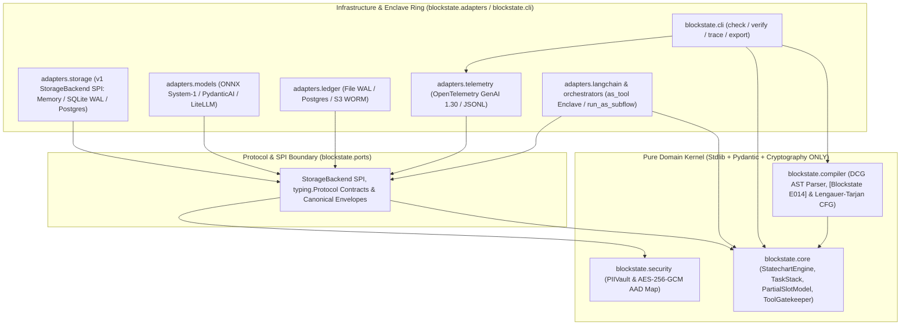
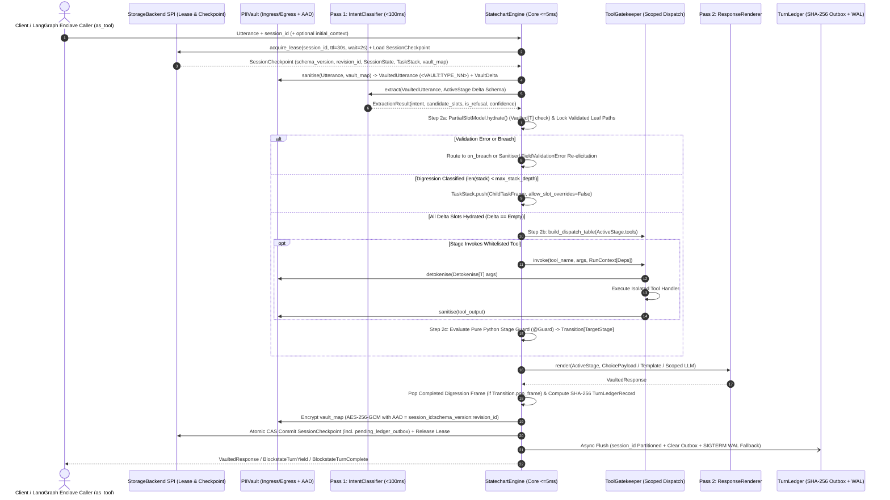
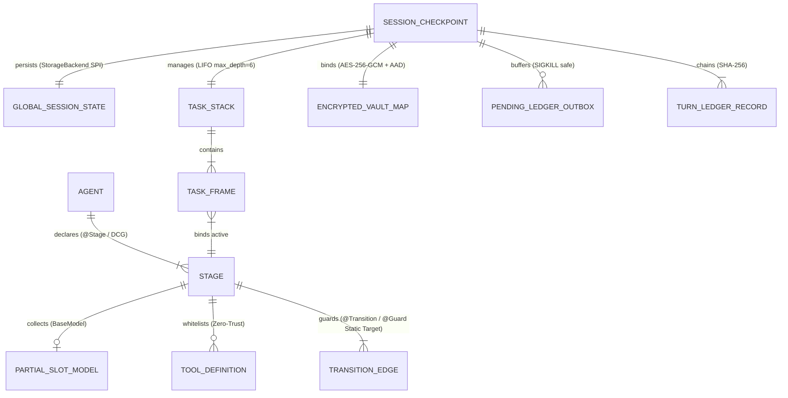
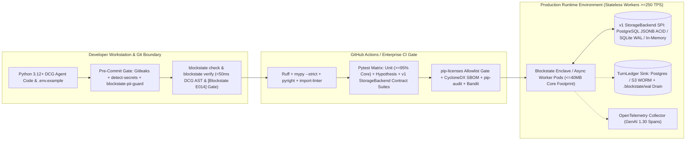

# Architecture Spine — Blockstate (`blockstate`)

## Design Paradigm

**Hexagonal Architecture (Ports & Adapters) wrapping a Deterministic Pushdown Statechart Core, Declarative Control Grammar (DCG), and a Two-Pass Turn Pipeline.**

Derived from railway absolute block signalling and deterministic state machines, **Blockstate (`blockstate`)** operates both as a standalone deterministic statechart runtime and as a **transactional compliance execution enclave** inside outer enterprise orchestrators (LangGraph, Microsoft Semantic Kernel, AutoGen, AWS Bedrock).

- **`blockstate.core` (Pure Domain Kernel):** Owns declarative `@Stage`, `@Transition`, and `@Guard` registration (`DuplicateStageError`, `ConfigurationError`), `StatechartEngine`, `TaskStack` pushdown automata (`TaskFrame` push/pop), `PartialSlotModel` recursive metaclass and delta-hydration, `ToolGatekeeper` ephemeral dispatch tables, and `TurnLedger` hash-chain computation. Zero external I/O or cloud SDK imports.
- **`blockstate.compiler` (Declarative Control Grammar AST & Graph Verification Engine):** Owns Python `ast` extraction constrained by the **Declarative Control Grammar (DCG)** (defeating Rice's Theorem undecidability by rejecting dynamic reflection with `[Blockstate E014]`), Control Flow Graph (CFG) construction, Lengauer-Tarjan dominator tree solver (`blockstate verify`), and Mermaid/JSON schema exporters (`blockstate export`). Executes offline with zero user-code evaluation.
- **`blockstate.security` (Zero-Trust & Sanitisation Boundary):** Owns `PIIVault` HMAC-keyed opaque tokenisation (`<VAULT:TYPE_NN>`), AES-256-GCM vault map encryption with AAD binding, and pre-commit PII/credential guard rules.
- **`blockstate.ports` (Protocol Boundaries & SPIs):** Pure `typing.Protocol` interfaces (`StorageBackend` SPI—aliasing `StateStore`, `IntentClassifier`, `ResponseRenderer`, `LedgerSink`, `PIIStripper`) and canonical wire data transfer objects (`TurnEnvelope`, `SessionCheckpoint`, `BlockstateTurnYield`, `BlockstateTurnComplete`, `BlockstateTurnAborted`).
- **`blockstate.adapters` (Pluggable Infrastructure & Enclave Ring):** Concrete drivers partitioned by canonical PEP 621 optional extras: Version 1 storage backends (`InMemoryStorageBackend`, `SQLiteStorageBackend` with WAL mode via `sqlite`, `PostgresStorageBackend` via `postgres` / `sql`), outer orchestrator enclave adapters (`blockstate.adapters.langchain.as_tool` / `blockstate.adapters.orchestrators`), ledger sinks (`s3`), model drivers (`models`, `litellm`, `onnx` with convenience aliases `local` and `system1`), observability (`otel`), and `all`. Redis, Microsoft SQL Server, and AWS DynamoDB storage drivers are formally deferred to v1.2+ behind the `StorageBackend` SPI.
- **`blockstate.cli` & `blockstate.testing` (Developer & Verification Surfaces):** Typer/Rich CLI (`blockstate check`, `blockstate verify`, `blockstate trace`, `blockstate export`) and reusable port `ContractSuite` classes (`StorageBackendContractSuite`, etc.) for adapter verification.



## Invariants & Rules

### AD-1 — Hexagonal Core Isolation & Canonical Optional Extras Boundary [ADOPTED]

- **Binds:** `all`, `FR-4`, `FR-13`, `FR-18`, `NFR-10.1`
- **Prevents:** External database drivers, ONNX runtimes, or LLM provider SDKs leaking into core modules, violating the `<= 40MB` memory ceiling or causing import-time network/driver side effects.
- **Rule:** `blockstate.core`, `blockstate.compiler`, `blockstate.security`, and `blockstate.ports` may import only from the Python 3.12+ standard library, `pydantic`, `pydantic_settings`, and `cryptography`. All v1 storage (`asyncpg`, `sqlalchemy`, `aiosqlite`), ledger archival (`aioboto3`), model (`pydantic_ai`, `litellm`, `onnxruntime`, `tokenizers`), and telemetry (`opentelemetry`) packages must live strictly inside `blockstate.adapters.*` gated behind canonical PEP 621 optional extras (`postgres`, `sqlite`, `sql`, `s3`, `models`, `litellm`, `onnx` with aliases `local` and `system1`, `otel`, and `all`). Enforced in CI via `import-linter` forbidden-import contracts.

### AD-2 — Single-Owner State Mutation, Declarative Control Grammar Decorators, Bounded `TaskStack` & Immutable Turn Envelope [ADOPTED]

- **Binds:** `FR-1`, `FR-2`, `FR-6`, `FR-8`, `FR-9`, `FR-22`, `SM-1`, `SM-7`
- **Prevents:** Pass 1 classifiers, tool handlers, stage guards, or child digression frames mutating `SessionState`, `TaskFrame` slots, or `vault_map` in-place, unconstrained imperative state mutations bypassing static verification, or unbounded nested digressions exhausting worker RAM (`<= 40MB`).
- **Rule:** Statechart definitions are authored strictly using the **Declarative Control Grammar (DCG)** decorators (`@Stage`, `@Transition`, `@Guard`) and static `Transition` state references. Exclusively `StatechartEngine.commit_turn()` inside `blockstate.core.engine` may commit mutations to `SessionCheckpoint` (`SessionState`, `TaskStack`, `vault_map`, `last_ledger_hash`, and `pending_ledger_outbox`). Stage guards, classifiers, and tool handlers receive a deep-frozen view (`ReadOnlySessionView`) and return declarative command objects (`SlotDelta`, `SlotMutation`, `VaultDelta`, `Transition`). Any attempt by a child `TaskFrame` on `TaskStack` to mutate parent frame slots raises `UnauthorisedMutationError` (`BLK-SEC-002`) unless the parent `@Stage` explicitly sets `allow_slot_overrides=True` and the child returns a typed `SlotMutation` directive. `TaskStack` enforces `max_stack_depth` (default `6`, raising `StackOverflowError` `BLK-SEC-003`) and `max_session_turns=50`, and completed digression frames (`Transition.pop_frame()`) are popped during `commit_turn()` *after* Pass 2 renders the digression response.

### AD-3 — Zero-Trust Physical Tool Gating, `RunContext[Deps]` & Ephemeral Dispatch Table [ADOPTED]

- **Binds:** `FR-4`, `FR-5`, `SM-2`, `NFR-10.2`
- **Prevents:** Global tool registries or fallback dispatchers allowing an LLM to execute tools belonging to an inactive stage via prompt injection or hallucinated function calls, or tools accessing ambient global state.
- **Rule:** No global callable tool registry may exist at runtime. On each turn, `ToolGatekeeper` builds an ephemeral, immutable `types.MappingProxyType[str, Callable]` and JSON tool schema containing solely the tools declared on the top `TaskFrame`'s active `@Stage`. Tool handlers execute in isolated scopes with access only to explicitly injected `RunContext[Deps]`. If a model or Pass 2 renderer emits a tool call for any function name absent from the active `MappingProxyType`, `ToolGatekeeper` raises `SecurityViolationError` (`BLK-SEC-001`), which `StatechartEngine` catches to abort tool execution, record a violation in `TurnLedgerRecord`, and transition atomically to the stage's declared `on_security_violation` / `on_breach` target (or abort with `BlockstateTurnAborted`).

### AD-4 — Declarative Control Grammar (DCG) AST Constraints, Rice's Theorem Boundary & Lengauer-Tarjan Dominator Proofs [ADOPTED]

- **Binds:** `FR-1`, `FR-2`, `FR-3`, `FR-7`, `FR-10`, `FR-11`, `FR-12`, `SM-3`, `SM-5`, `SM-C2`, `NFR-10.2`
- **Prevents:** Rice's Theorem undecidability from arbitrary Turing-complete Python reflection (`getattr(self, dynamic_state)()`, `eval()`, `exec()`, computed variable targets), duplicate/unnamed stages, transition targets hidden inside Pydantic `@field_validator` methods, or shared digressions creating false-positive or false-negative dominator paths.
- **Rule:** By **Rice's Theorem**, semantic properties of arbitrary, unconstrained Python code are mathematically undecidable. To guarantee decidable, sound, and complete compile-time verification, `blockstate.compiler` enforces the **Declarative Control Grammar (DCG)** over Python's `ast` module:
  - Defining duplicate stage identifiers raises `DuplicateStageError` (`BLK-CFG-001`); omitting a stage name raises `ConfigurationError` (`BLK-CFG-002`).
  - Statechart topology definitions are restricted exclusively to declarative decorators (`@Stage`, `@Transition`, `@Guard`) and static `Transition` state references (`Transition["target_a" | "target_b"]` or `Transition[None]`), plus declarative `@Stage` fallback arguments (`on_breach`, `on_max_turns_exceeded`, `on_refusal`, `on_security_violation`, `allow_digressions`).
  - `blockstate check` and `blockstate verify` parse Python source via `ast.parse` without executing user code (`SM-C2` prioritises full AST depth over raw compile speed, targeting `< 50ms` for up to 500 nodes). Any dynamic reflection (`getattr`, `setattr`, `globals()`, `eval()`, `exec()`), computed transition variable, or non-static transition destination terminates the build immediately with diagnostic code **`[Blockstate E014]`** (`BLK-AST-014`):
    ```text
    [Blockstate E014] Dynamic transition destination detected at mortgage_flow.py:42.
    Transitions must reference static State definitions to enable Lengauer-Tarjan dominator verification.
    ```
  - Reports syntax or transition violations with exact `(filename, lineno)` (`BLK-AST-001`), flags unreachable dead stages (`BLK-AST-002`), and rejects any `Transition` reference inside `@field_validator` methods.
  - Verifies `allow_digressions` sub-graphs under pushdown call-return semantics: a digression sub-graph must terminate exclusively via `Transition.pop_frame()` / `Transition[None]` (returning to its caller) or a terminal escalation stage; jumping directly from a digression into an arbitrary main-flow stage is rejected at compile time.
  - Runs Lengauer-Tarjan dominator tree verification (`blockstate verify --dominates`) across all branches, exiting with code `0` (emitting a JSON/Markdown audit certificate) or code `1` (printing the exact violating counter-example path).

### AD-5 — Recursive `PartialSlotModel` Metaclass, `Vaulted[T]` & Leaf-Path Delta-Hydration [ADOPTED]

- **Binds:** `FR-6`, `FR-7`, `SM-5`, `SM-7`
- **Prevents:** Inconsistent validation between flat and deeply nested Pydantic models during multi-turn collection, re-prompting for already-validated fields when a sibling field fails, or `<VAULT:TYPE_NN>` opaque tokens failing regex/checksum `@field_validator` rules.
- **Rule:** `PartialSlotMetaclass` transforms a stage's `collect=TargetModel` (and recursively all nested `BaseModel` attributes up to `max_nesting_depth=8`) into a partial schema where required fields default to the `UNSET` singleton while preserving all `@field_validator(mode="after")` validators on provided values. For fields annotated with `Vaulted[T]`, `SlotHydrator` performs an isolated, zero-persistence in-memory detokenisation strictly during `@field_validator` execution and immediately re-binds the `<VAULT:CATEGORY_NN>` token to the hydrated slot attribute. After Pass 1 extraction, `SlotHydrator` computes $\Delta = \text{RequiredLeafPaths} \setminus \text{HydratedLeafPaths}$ in deterministic declaration order. Validated leaf paths lock in `TaskFrame.locked_slots` (`SM-7`). Invalid leaf paths capture sanitised `FieldValidationError` objects (using `exc.errors(include_input=False, include_context=False)` so raw rejected inputs never leak into logs or prompts) that either trigger `on_breach` transition immediately or short-circuit Pass 2 to re-elicit only the invalid leaf paths. The strict `TargetModel` is instantiated once and only once when $\Delta = \emptyset$.

### AD-6 — Two-Pass Turn Loop, Ordered Phase-2 Sub-Steps & Latency/Throughput Envelope [ADOPTED]

- **Binds:** `FR-3`, `FR-13`, `FR-14`, `SM-4`, `SM-C1`, `NFR-10.1`
- **Prevents:** Pass 1 classifiers blocking the `< 100ms` routing budget, stage guards running before stage tools have produced required verification outputs, or unmapped user intents triggering probabilistic transition guessing (`SM-C1`).
- **Rule:** Every conversational turn executes as a three-phase async pipeline over a canonical `TurnEnvelope` sustaining `>= 250` concurrent turns/sec per 2 vCPU worker (`NFR-10.1`):
  1. **Pass 1 (`IntentClassifier.extract`):** Accepts `VaultedUtterance` and the active stage's unhydrated $\Delta$ JSON schema, returning `ExtractionResult(intent, candidate_slots, is_refusal, confidence, latency_ms)` under a hard `pass1_timeout_ms` budget (default `100ms`; local ONNX System-1 classifiers execute via `asyncio.to_thread` achieving p95 `<= 50ms`). If `is_refusal=True`, the engine immediately invokes the stage's `on_refusal` transition (defaulting to `1` refusal threshold per PRD §8.5). If an utterance cannot be mapped to a valid slot, transition, or permitted digression, the engine fails safe into clarification or escalation (`SM-C1`), never guessing.
  2. **Core Resolution (`StatechartEngine.step`, `<= 5ms` framework overhead):** Executes sequentially as:
     - **Step 2a (Hydrate $\Delta$):** Hydrate and lock validated leaf paths, check `turn_count > max_turns` (default `5`, disabled when `None` or `<= 0`), or push a child `TaskFrame` on permitted digression.
     - **Step 2b (Scoped Stage Tool Execution):** When $\Delta = \emptyset$, execute any whitelisted `self.tools.*` calls invoked by the `@Stage` method body via `ToolGatekeeper.invoke()`, merging sanitised `SlotMutation` results.
     - **Step 2c (Pure Python Stage Guard Evaluation):** Evaluate the `@Stage` / `@Guard` method's returned `Transition[...]` over validated slots and tool outputs to resolve the target stage.
  3. **Pass 2 (`ResponseRenderer.render`):** If the resolved stage declares `canned_response` or `choice_options` (`ChoicePayload`), dispatches deterministically in `< 15ms` (`< 120ms` end-to-end turn SLA, `FR-14`/`SM-4`); otherwise invokes the configured `PydanticAI` or `LiteLLM` adapter (`< 200ms` p95 for SLM turns, `SM-4`) with the active stage's scoped tool schema.

### AD-7 — Post-Lease `PIIVault` Tokenisation, AAD Encryption & Scoped Detokenisation [ADOPTED]

- **Binds:** `FR-15`, `NFR-10.2`
- **Prevents:** Raw customer PII, PHI, or credentials leaking into third-party LLM prompts, Pydantic `ValidationError` messages, OpenTelemetry traces, `TurnLedger` records, or `.blockstate/traces.jsonl`, or cross-turn token collisions overwriting historical session PII mappings.
- **Rule:** Immediately after `StorageBackend.acquire_lease()` loads `SessionCheckpoint` (including the session's existing `vault_map` counters), `PIIVault.sanitise()` executes at the ingress gate prior to Pass 1. It replaces detected sensitive spans with deterministic, HMAC-SHA256 session-scoped tokens (`<VAULT:CATEGORY_INDEX>`, monotonically indexed per session via `VaultDelta`) and encrypts `SessionCheckpoint.vault_map` inside `blockstate.security.vault` prior to crossing the `StorageBackend` boundary using AES-256-GCM (`BLOCKSTATE_VAULT_SECRET_KEY`) bound to Associated Authenticated Data `AAD = f"<session_id>:<schema_version>:<revision_id>"` `[ASSUMPTION-A2]`. Outbound LLM prompts, `TurnLedger` entries, exception formatters (`capture_locals=False`), and OpenTelemetry spans receive only vaulted strings. Runtime detokenisation outside `Vaulted[T]` validator checks is physically restricted to `ToolGatekeeper.invoke()` for tool parameters typed as `Detokenise[T]` (or explicit `context.vault.detokenise(token)` inside an authorised tool handler), and all tool outputs are re-sanitised by `PIIVault.sanitise()` before entering session state or Pass 2 context.

### AD-8 — Single-Writer Hash-Chained `TurnLedger`, Transactional Outbox & `SIGTERM` WAL Drain [ADOPTED]

- **Binds:** `FR-16`, `FR-17`, `SM-6`
- **Prevents:** Dual writers or concurrent distributed workers scrambling causal turn order and forking the SHA-256 hash chain, or container `SIGKILL`/`SIGTERM` shutdowns losing un-flushed regulatory audit records required by EU AI Act Article 12.
- **Rule:** `StatechartEngine.commit_turn()` is the sole producer of `TurnLedgerRecord`, computing it synchronously before releasing the session lease: `record_hash = SHA256(RFC8785_JCS(prev_record_hash, session_id, turn_index, stage_from, stage_to, exposed_tools, prompt_hash, vaulted_input_hash, vaulted_output_hash, guard_outcome, timestamp_utc))`. Both `last_ledger_hash = record_hash` and a bounded `pending_ledger_outbox` tuple are persisted atomically inside `SessionCheckpoint` so stateless worker pods can recover un-flushed records even after a hard `SIGKILL`. Asynchronous emission to `LedgerSink` drivers (`PostgresLedgerSink`, `S3LedgerSink`, `FileLedgerSink`) routes through a `session_id`-partitioned ring buffer (`turn_index` monotonically ordered) that clears acknowledged outbox entries and registers a 10-second `SIGTERM`/`SIGINT` drain hook spilling remaining records to a local Write-Ahead Log (`.blockstate/wal/ledger.wal`).

### AD-9 — Version 1 Storage Slicing (`StorageBackend` SPI), Fail-Fast Session Leasing, Atomic Checkpointing & Schema Upcasting [ADOPTED]

- **Binds:** `FR-18`, `FR-19`, `FR-22`
- **Prevents:** Engineering velocity and CI matrix drag from maintaining connection pools, schema migrations, and concurrency locks across 5+ heterogeneous persistence backends in v1, concurrent customer requests causing race conditions, crashed workers permanently locking a session, or rolling deployments failing to deserialise in-flight sessions.
- **Rule:** `src/blockstate/ports/storage.py` defines the formal asynchronous **`StorageBackend` SPI** (`StorageBackend` protocol, aliased as `StateStore` for backwards compatibility). **Version 1 slices storage strictly to three canonical backends**:
  1. **In-Memory (`InMemoryStorageBackend` in `src/blockstate/adapters/storage/memory.py`):** Hermetic unit testing and fast CI/CD verification.
  2. **Local SQLite with WAL mode (`SQLiteStorageBackend` in `src/blockstate/adapters/storage/sqlite.py` via `aiosqlite` with `PRAGMA journal_mode=WAL`):** Zero-dependency local development and single-node edge deployments (`.blockstate/state.db`).
  3. **PostgreSQL via async SQLAlchemy (`PostgresStorageBackend` in `src/blockstate/adapters/storage/postgres.py` via `SQLAlchemy[asyncio]` + `asyncpg` JSONB ACID):** Cloud production workloads.
  **Redis, Microsoft SQL Server, and AWS DynamoDB are formally deferred to v1.2+** via the `StorageBackend` SPI. Every `StorageBackend` implementation must wrap the entire turn lifecycle—starting prior to `PIIVault.sanitise()`—in `acquire_lease(session_id, ttl_ms=30000, wait_timeout_ms=2000)` returning a fenced `LeaseHandle` with an automatic background heartbeat renewing the lease every `10000ms` during active turn or tool execution; failing to acquire within `2000ms` immediately raises `ConcurrentSessionError` (`BLK-CON-409`). `SessionCheckpoint` (`SessionState`, `TaskStack`, `last_ledger_hash`, `pending_ledger_outbox`, and AAD-encrypted `vault_map`) is committed atomically in a single store operation verifying both `LeaseHandle` ownership and monotonic `revision_id: int` (optimistic Compare-And-Swap) alongside `schema_version: int`. Loading a checkpoint with an older `schema_version` executes registered pure `SchemaUpcaster` functions (`v_n -> v_n+1`) prior to Pydantic model hydration.

### AD-10 — Outer Orchestrator Entrypoint (`as_tool()` Transactional Compliance Enclave Adapter) & Bidirectional Handoff Envelope [ADOPTED]

- **Binds:** `FR-20`
- **Prevents:** The **"Enterprise Island Trap"**—forcing enterprises with millions invested in LangGraph, Microsoft Semantic Kernel, AutoGen, or AWS Bedrock to rip-and-replace their existing conversational estate—or allowing outer general-purpose LLM orchestrators to bypass Blockstate stage guards, mutate internal slots, or leak un-vaulted `initial_context` PII.
- **Rule:** Blockstate positions itself not as a replacement for high-level conversational routers, but as a **transactional compliance execution enclave**. High-level orchestrators handle open-ended greeting, routing, and Q&A, then invoke a formal Blockstate statechart via the first-class `as_tool()` adapter (`src/blockstate/adapters/langchain.py` and `src/blockstate/adapters/orchestrators.py`):
  ```python
  from blockstate.adapters.langchain import as_tool
  from my_regulated_workflows import MortgageOriginationEnclave

  # Expose the entire formal statechart as a single validated tool to LangGraph
  langgraph_agent.bind_tools([
      as_tool(MortgageOriginationEnclave, name="execute_mortgage_transaction")
  ])
  ```
  Both `as_tool(EnclaveClass, name=...)` / `Agent.as_tool(name=...)` (callable single-turn enclave tool adapter) and `Agent.run_as_subflow()` (async single-turn coroutine and `AsyncIterator` streaming generator) accept only `(session_id: str, user_message: str, initial_context: Mapping[str, Any] | None = None)`—recursively sanitising `initial_context` through `PIIVault.sanitise_mapping()` at ingress—and yield/return a strict discriminated union keyed on `state`: `BlockstateTurnYield(session_id, state="in_progress", message, choices, missing_slots)`, `BlockstateTurnAborted(session_id, state="aborted", error_code, reason)`, or `BlockstateTurnComplete[T](session_id, state="completed", result: T, ledger_head_hash)`. Outer orchestrators have zero access to `StatechartEngine` internals or stage dispatch tables.

### AD-11 — Enforced Multi-Tier Coverage, `as_tool()` Enclave Verification, Property Fuzzing & Port Contract Suites [ADOPTED]

- **Binds:** `all`, `FR-18`, `FR-20`, `SM-1`, `SM-2`, `SM-3`, `SM-7`
- **Prevents:** High superficial line coverage masking untested branch edges, boundary crashes, `as_tool()` enclave handoff regressions, or subtle behavioural divergence across the three v1 `StorageBackend` implementations (In-Memory, SQLite WAL, and PostgreSQL).
- **Rule:** CI enforces `pytest --cov=blockstate --cov-branch` with non-negotiable failure thresholds:
  - **Tier 1 (`blockstate.core`, `blockstate.compiler`, `blockstate.security`):** `>= 95%` line coverage and `>= 90%` branch coverage.
  - **Tier 2 (Full repository including `blockstate.adapters` and `blockstate.cli`):** `>= 90%` line coverage and `>= 85%` branch coverage.
  - **Port & Enclave Contract Suites:** `blockstate.testing.contracts` defines mandatory pytest base classes for all five ports (`StorageBackendContractSuite`—aliased as `StateStoreContractSuite`, `LedgerSinkContractSuite`, `PIIStripperContractSuite`, `IntentClassifierContractSuite`, `ResponseRendererContractSuite`) plus `OrchestratorEnclaveContractSuite` verifying `from blockstate.adapters.langchain import as_tool` multi-turn enclave execution (`AD-10`). Every v1 storage backend (`InMemoryStorageBackend`, `SQLiteStorageBackend` with `PRAGMA journal_mode=WAL`, and `PostgresStorageBackend`) subclasses and passes 100% of `StorageBackendContractSuite` on every Pull Request (testing concurrency contention, lease TTL expiry, CAS revision conflict, 64KB payloads, max nesting depth 8, Unicode zero-width/RTL characters, null bytes, and idempotency).
  - **Property-Based Fuzzing (`Hypothesis`):** CI runs `Hypothesis` strategies (`max_examples=500`, deterministic seed logging) verifying `PartialSlotModel` recursive hydration invariants, `[Blockstate E014]` DCG rejection of dynamic AST nodes, and Lengauer-Tarjan dominator equivalence against brute-force path enumeration on random directed graphs.

### AD-12 — Permissive Subcomponent Licence Gate & Automated SBOM Provenance [ADOPTED]

- **Binds:** `all`
- **Prevents:** Viral copyleft licences (`GPL`, `AGPL`, `LGPL`, `SSPL`, `EUPL`) entering the runtime dependency tree or documentation drifting from locked dependencies.
- **Rule:** All core and optional runtime dependencies (`project.dependencies` and `project.optional-dependencies`) must be licensed under the strict enterprise allowlist: `MIT`, `Apache-2.0`, `BSD-2-Clause`, `BSD-3-Clause`, `PSF-2.0`, or `ISC`. Dev-only dependencies (`MPL-2.0` for `hypothesis`) must never be imported by runtime packages. CI runs `pip-licenses --allow-only="MIT;Apache-2.0;BSD-2-Clause;BSD-3-Clause;Python-2.0;ISC"` against the installed runtime environment and `cyclonedx-py` to generate `sbom.cdx.json`, failing the build if `THIRD_PARTY_LICENSES.md` is out of sync with `uv.lock` `[ASSUMPTION-A1]`.

### AD-13 — Zero-Leakage Git Hooks, Secret Scanning & Typed `SecretStr` Environment Boundary [ADOPTED]

- **Binds:** `all`, `NFR-10.2`
- **Prevents:** Accidental git commits of PII, API keys, database credentials, `.env` files, or local trace/WAL files into repository history.
- **Rule:** Repository enforces a multi-layered `.pre-commit-config.yaml` executing on both `pre-commit` and `pre-push` hooks (and replicated as the first stage in CI):
  1. `gitleaks` (`v8.30.1`) staged and full-history secret detection.
  2. `detect-secrets` (`v1.5.0`) high-entropy string and private-key blocker against `.secrets.baseline`.
  3. `blockstate-pii-guard` blocking raw PII test patterns (real UK NINo, NHS numbers, US SSN, live credit card Luhn matches, live postcodes outside reserved OFCOM/fictional ranges) and blocking any staged `.env` (other than `.env.example`), `.blockstate/`, `*.wal`, `*.db`, `*.pem`, or `*.key` file.
  All environment variables are loaded exclusively through `BlockstateSettings(BaseSettings)` (`BLOCKSTATE_` prefix) where every credential, connection string, and encryption key is typed as `pydantic.SecretStr` with strict startup validation.

### AD-14 — Structured Error Taxonomy, 12-Factor JSON Logging & OpenTelemetry GenAI 1.30 [ADOPTED]

- **Binds:** `FR-21`, `SM-6`, `NFR-10.3`
- **Prevents:** Unstructured exception strings, raw PII in tracebacks, or inconsistent trace schemas breaking `blockstate trace` terminal replay or enterprise SIEM correlation.
- **Rule:** All framework exceptions subclass `BlockstateError` with mandatory fields `(code: str, message: str, stage: str | None, session_id: str | None, turn_index: int | None)` partitioned by namespace (`BLK-CFG-*`, `BLK-AST-*` including `[Blockstate E014]`, `BLK-SEC-*`, `BLK-VAL-*`, `BLK-CON-*`, `BLK-MOD-*`). Structured JSON logs are emitted to `stdout` per 12-factor standards (`NFR-10.3`) with `capture_locals=False` on exception tracebacks. Every turn emits OpenTelemetry GenAI 1.30 semantic spans (`gen_ai.agent.turn`, `blockstate.pass1.extract`, `blockstate.core.guard`, `blockstate.tool.invoke`, `blockstate.pass2.render`) and appends a post-`PIIVault` JSONL record to `.blockstate/traces.jsonl` consumed by `blockstate trace --session <id> [--file <path>] [--format table|json]` (which also supports reading directly from configured `StorageBackend`/`TurnLedger` backends).

## Consistency Conventions

| Concern | Convention |
| --- | --- |
| **Language & Spelling** | Strict **British English** (`sanitise`, `tokenise`, `serialise`, `authorise`, `behaviour`, `colour`) across all docs, CLI output, comments, and public methods (`PIIVault.sanitise()`, `Detokenise[T]`). |
| **Naming (Python & Modules)** | Packages/modules: `snake_case` (`blockstate.*`); Classes/Protocols/Models: `PascalCase`; Stages: lower `snake_case` string IDs (`@Stage(name="verify_identity")`); Constants: `UPPER_SNAKE_CASE`. |
| **Type Safety & Annotations** | Python 3.12+ PEP 695 syntax (`type TransitionTarget[T] = ...`, `class BlockstateTurnComplete[T]:`). PEP 561 `py.typed` marker included; 100% clean under `mypy --strict` and `pyright`. |
| **Data & Wire Formats** | Session IDs: `UUIDv7` (delegating to `uuid.uuid7()` on Python 3.14+ with a pure-stdlib RFC 9562 helper on Python 3.12/3.13); Timestamps: ISO-8601 UTC (`YYYY-MM-DDTHH:MM:SS.ffffffZ`); Hash canonicalisation: pure-stdlib RFC 8785 JCS (`sort_keys=True, separators=(",", ":")`, restricted to strings, ints, booleans, and `None`) prior to SHA-256. |
| **Error Codes & Envelopes** | Deterministic codes `BLK-<DOMAIN>-<NNN>` and compiler diagnostics `[Blockstate E014]` (`BLK-CFG-001` Duplicate Stage, `BLK-AST-001` Invalid Stage Graph, `[Blockstate E014]` / `BLK-AST-014` Dynamic Transition Destination Violating DCG, `BLK-SEC-001` Unauthorised Tool, `BLK-SEC-002` Unauthorised Slot Mutation, `BLK-SEC-003` TaskStack Overflow, `BLK-CON-409` Session Lease Conflict). |
| **State & Concurrency** | Copy-on-write frozen Pydantic models (`ConfigDict(frozen=True, extra="forbid")`) for all wire envelopes (`TurnEnvelope`, `TurnLedgerRecord`, `SessionCheckpoint`). Async-first (`async def`) across all runtime and port methods; CPU-bound local ONNX inference offloaded via `asyncio.to_thread`. |
| **Configuration & Secrets** | 12-Factor environment variables prefixed with `BLOCKSTATE_` (`BLOCKSTATE_ENV`, `BLOCKSTATE_STORAGE_BACKEND`, `BLOCKSTATE_VAULT_SECRET_KEY`), parsed via `pydantic-settings` with `SecretStr` masking. |

## Stack

| Name | Version |
| --- | --- |
| Python | `>=3.12,<3.15` (PSF-2.0) |
| uv & Hatchling (Build / Lockfile) | `>=0.13.6` / `>=1.27.0` (MIT / Apache-2.0) |
| Pydantic | `>=2.14.1,<3.0` (MIT) |
| Pydantic-Settings | `>=2.16.1,<3.0` (MIT) |
| Cryptography | `>=50.0.2,<51.0` (Apache-2.0 / BSD-3-Clause) |
| Typer | `>=0.27.3,<1.0` (MIT) |
| Rich | `>=15.0.0,<16.0` (MIT) |
| PydanticAI (`pydantic-ai-slim`) | `>=2.61.0,<3.0` (MIT — optional extra `models`) |
| LiteLLM | `>=1.106.0,<1.107.0` (MIT — optional extra `litellm`, pinned below pulled `1.107.0`) |
| ONNX Runtime & Tokenizers | `>=1.31.0,<2.0` / `>=0.23.0,<1.0` (MIT / Apache-2.0 — optional extra `onnx`, aliased as `local`, `system1`) |
| OpenTelemetry API & SDK | `>=1.45.1,<2.0` (Apache-2.0 — optional extra `otel`) |
| SQLAlchemy (Async) | `>=2.1.6,<3.0` (MIT — v1 `StorageBackend` extra `sql` / `postgres`) |
| asyncpg | `>=0.32.0,<1.0` (Apache-2.0 — v1 `PostgresStorageBackend` extra `postgres`) |
| aiosqlite | `>=0.22.1,<1.0` (MIT — v1 `SQLiteStorageBackend` WAL mode extra `sqlite`) |
| aioboto3 & botocore | `>=15.5.0,<16.0` / `>=1.43.0` (Apache-2.0 — optional extra `s3`) |
| pytest, pytest-asyncio & pytest-cov | `>=9.1.1,<10.0` / `>=1.4.0,<2.0` / `>=7.1.0,<8.0` (MIT / Apache-2.0 — dev/test) |
| Hypothesis | `>=6.170.0,<7.0` (MPL-2.0 — dev/test only, isolated from runtime) |
| Ruff | `>=0.17.0,<1.0` (MIT — dev/lint) |
| mypy & pyright | `>=2.4.0,<3.0` / `>=1.1.414,<2.0` (MIT — dev/typecheck) |
| import-linter | `>=2.15.1,<3.0` (BSD-3-Clause — dev/architecture gate) |
| Gitleaks & detect-secrets | `>=8.30.1` / `>=1.5.0` (MIT / Apache-2.0 — pre-commit security gate) |
| pip-licenses, cyclonedx-bom, pip-audit & bandit | `>=5.5.5` / `>=7.5.0` / `>=2.10.1` / `>=1.9.4` (MIT / Apache-2.0 — CI licence, SBOM & SAST gate) |

## Structural Seed

### 1. Runtime Execution & Two-Pass Zero-Trust Sequence



### 2. Core Domain Entity Relationships



### 3. Operational, CI/CD & Deployment Envelope



### 4. Repository & Package Source Tree

```text
blockstate/
  .github/
    workflows/
      ci.yml                        # Lint, typecheck, import-linter, coverage gates, v1 contract tests, licence/SBOM gate
      security.yml                  # Gitleaks, pip-audit, Bandit SAST, CycloneDX attestation
  src/
    blockstate/
      __init__.py                   # Public exports: Agent, Stage, Transition, Guard, ChoicePayload, Detokenise, Vaulted, BlockstateSettings
      py.typed                      # PEP 561 strict typing marker
      config.py                     # BlockstateSettings (pydantic-settings, BLOCKSTATE_ prefix, SecretStr env contract)
      errors.py                     # BlockstateError hierarchy & deterministic BLK-* / [Blockstate E014] error codes
      ports/
        __init__.py
        storage.py                  # StorageBackend SPI Protocol (aliased as StateStore) & SessionCheckpoint / LeaseHandle DTOs
        models.py                   # IntentClassifier & ResponseRenderer Protocols
        ledger.py                   # LedgerSink Protocol & TurnLedgerRecord DTO
        security.py                 # PIIStripper Protocol
      core/
        __init__.py
        agent.py                    # Agent base class & @Stage, @Transition, @Guard DCG decorator registry
        engine.py                   # StatechartEngine (single-owner state mutation & Two-Pass coordinator)
        stack.py                    # TaskStack & TaskFrame pushdown automata (strict slot isolation & max_stack_depth)
        slots.py                    # PartialSlotMetaclass, Vaulted[T], UNSET sentinel & recursive leaf-path Delta-Hydration
        gatekeeper.py               # ToolGatekeeper, RunContext[Deps] & frozen MappingProxyType dispatch table
        transitions.py              # Transition[T], ChoicePayload & pure guard evaluation primitives
      compiler/
        __init__.py
        dcg_validator.py            # Declarative Control Grammar (DCG) AST verifier & [Blockstate E014] reflection blocker
        ast_extractor.py            # Zero-execution Python AST parser & call-return CFG builder
        dominators.py               # Lengauer-Tarjan dominator tree algorithm & counter-example path finder
        exporters.py                # Mermaid statechart & JSON schema generators
      security/
        __init__.py
        vault.py                    # PIIVault HMAC tokeniser (<VAULT:TYPE_NN>) & AES-256-GCM AAD vault_map cipher
        pii_patterns.py             # Built-in regex/checksum detectors (NINo, NHS, SSN, Postcode, Credit Card, Email, Phone)
        git_guard.py                # Pre-commit PII & credential file/diff scanner entrypoint (blockstate-pii-guard)
      adapters/
        storage/
          memory.py                 # InMemoryStorageBackend (v1 reference implementation for hermetic unit tests & CI)
          sqlite.py                 # SQLiteStorageBackend (v1 aiosqlite with PRAGMA journal_mode=WAL for local/edge)
          postgres.py               # PostgresStorageBackend (v1 SQLAlchemy[asyncio] + asyncpg JSONB ACID for cloud prod)
        models/
          onnx_classifier.py        # System-1 ONNX Runtime / ModernBERT fast classifier (<50ms via asyncio.to_thread)
          pydantic_ai_adapter.py    # PydanticAI Pass 1 / Pass 2 model adapter
          litellm_adapter.py        # LiteLLM enterprise gateway adapter
        ledger/
          ring_buffer.py            # Session-partitioned async queue + outbox ack + SIGTERM .blockstate/wal drain
          file_sink.py              # Local JSONL / WAL ledger sink
          postgres_sink.py          # Append-only PostgreSQL audit ledger sink
          s3_sink.py                # Immutable S3 Object-Lock batch sink (aioboto3)
        telemetry/
          otel.py                   # OpenTelemetry GenAI 1.30 span emitter
          local_trace.py            # .blockstate/traces.jsonl writer & reader
        langchain.py                # First-class as_tool() transactional compliance enclave adapter for LangGraph / LangChain
        orchestrators.py            # Generic as_tool() & run_as_subflow() enclave bridge for Semantic Kernel / AutoGen / Bedrock
      cli/
        __init__.py
        main.py                     # Typer CLI root (blockstate check, verify, trace, export)
      testing/
        __init__.py
        contracts.py                # StorageBackend, LedgerSink, PIIStripper, IntentClassifier, ResponseRenderer & Enclave ContractSuites
        strategies.py               # Hypothesis strategies for arbitrary Pydantic schemas, DCG AST nodes & directed graphs
  tests/
    unit/                           # Core, compiler (incl. [Blockstate E014]), and security unit & boundary tests (>=95% line / >=90% branch)
    property/                       # Hypothesis property-based fuzzing suites (500+ examples per invariant)
    contracts/                      # StorageBackendContractSuite executions across v1 Memory, SQLite WAL, and PostgreSQL
    integration/                    # End-to-end multi-turn agent journeys (UJ-1, UJ-2, UJ-3) & LangGraph as_tool() enclave handoffs
  examples/
    01_motor_insurance_claim.py     # Multi-turn slot filling, TaskStack FAQ digression, and tiered payout branching
    02_banking_kyc_dominator.py     # Multi-branch KYC dominance verification & ChoicePayload disclosure
    03_healthcare_hipaa_vault.py    # PIIVault PHI tokenisation, Detokenise[T] tool boundary, and TurnLedger verification
    04_langchain_subflow_handoff.py # LangGraph outer orchestrator enclave integration via from blockstate.adapters.langchain import as_tool
  .env.example                      # Documented 12-factor BLOCKSTATE_ environment template with zero real secrets
  .gitignore                        # First-class Python, secret, database, .blockstate/, WAL, and trace exclusions
  .pre-commit-config.yaml           # Gitleaks, detect-secrets, blockstate-pii-guard, ruff, mypy hooks
  pyproject.toml                    # PEP 621 metadata (name = "blockstate"), optional extras, pytest/coverage/import-linter/ruff/mypy config
  README.md                         # Public-facing high-traffic repository documentation
  THIRD_PARTY_LICENSES.md           # Complete audited subcomponent licence manifest
  SECURITY.md                       # Zero-trust threat model, vulnerability disclosure, and secret hygiene policy
```

## Capability → Architecture Map

| Capability / Area | Lives in | Governed by |
| --- | --- | --- |
| `FR-1` Declarative `@Stage` Definition (`DuplicateStageError`, `ConfigurationError`) | `blockstate.core.agent` | `AD-1`, `AD-2`, `AD-4` |
| `FR-2` Pure Python Stage Guards (`@Guard`, `@Transition`) & Validator Boundary | `blockstate.core.transitions`, `blockstate.compiler.dcg_validator` | `AD-2`, `AD-4`, `SM-1` |
| `FR-3` Optional `max_turns` & Refusal Circuit Breaking (`on_refusal`) | `blockstate.core.engine` | `AD-4`, `AD-6`, `AD-14` |
| `FR-4` Dynamic Schema Scoping | `blockstate.core.gatekeeper` | `AD-1`, `AD-3`, `SM-2` |
| `FR-5` Memory-Isolated Tool Dispatch Table (`BLK-SEC-001`) | `blockstate.core.gatekeeper`, `blockstate.core.engine` | `AD-3`, `AD-14`, `SM-2` |
| `FR-6` Recursive `PartialSlotModel` & `Vaulted[T]` Transformation | `blockstate.core.slots` | `AD-2`, `AD-5`, `AD-11`, `SM-5`, `SM-7` |
| `FR-7` $\Delta$-Hydration, Error Short-Circuiting & `on_breach` | `blockstate.core.slots`, `blockstate.core.engine` | `AD-4`, `AD-5`, `SM-7` |
| `FR-8` `TaskStack` Push with Strict Slot Isolation & `max_stack_depth` | `blockstate.core.stack` | `AD-2`, `AD-3`, `SM-5`, `SM-7` |
| `FR-9` `TaskStack` Pop After Render & Explicit `allow_slot_overrides` | `blockstate.core.stack`, `blockstate.core.engine` | `AD-2`, `SM-7` |
| `FR-10` Declarative Control Grammar AST Extraction (`blockstate check`, `[Blockstate E014]`, `< 50ms`) | `blockstate.compiler.dcg_validator`, `blockstate.compiler.ast_extractor`, `blockstate.cli.main` | `AD-1`, `AD-4`, `SM-3`, `SM-C2` |
| `FR-11` Lengauer-Tarjan Dominator Proofs (`blockstate verify`) | `blockstate.compiler.dominators`, `blockstate.cli.main` | `AD-4`, `AD-11`, `SM-3`, `SM-C2` |
| `FR-12` Mermaid & JSON Topology Export (`blockstate export`) | `blockstate.compiler.exporters`, `blockstate.cli.main` | `AD-4` |
| `FR-13` Sub-100ms Pass 1 Routing (System-1 ONNX `<= 50ms` p95 & SLMs) | `blockstate.ports.models`, `blockstate.adapters.models` | `AD-1`, `AD-6`, `SM-4`, `SM-C1` |
| `FR-14` Pass 2 Template Dispatch & `ChoicePayload` (`< 120ms` E2E) | `blockstate.core.transitions`, `blockstate.adapters.models` | `AD-6`, `SM-4` |
| `FR-15` Post-Lease `PIIVault` Boundary, AAD Cipher & `Detokenise[T]` | `blockstate.security.vault`, `blockstate.core.gatekeeper` | `AD-7`, `AD-11`, `AD-13` |
| `FR-16` Tamper-Evident SHA-256 Hash Chaining (`TurnLedgerRecord`) | `blockstate.core.engine`, `blockstate.ports.ledger` | `AD-8`, `SM-6` |
| `FR-17` Async Session-Partitioned Ledger, Outbox & `SIGTERM` WAL Drain | `blockstate.adapters.ledger.ring_buffer` | `AD-8`, `AD-9` |
| `FR-18` `StorageBackend` SPI & v1 Storage Slicing (In-Memory, SQLite WAL, PostgreSQL) | `blockstate.ports.storage`, `blockstate.adapters.storage.*` | `AD-1`, `AD-9`, `AD-11` |
| `FR-19` Distributed Session Lease (`2s` fail-fast, `30s` TTL, `10s` heartbeat) | `blockstate.ports.storage`, `blockstate.adapters.storage.*` | `AD-9`, `AD-11` |
| `FR-20` Transactional Compliance Enclave Entrypoint (`as_tool()`, `run_as_subflow()`) | `blockstate.adapters.langchain`, `blockstate.adapters.orchestrators` | `AD-10`, `AD-11` |
| `FR-21` Local & Store Session Trace Replay (`blockstate trace`) | `blockstate.adapters.telemetry.local_trace`, `blockstate.cli.main` | `AD-7`, `AD-14`, `SM-6` |
| `FR-22` Two-Tier Memory Contract (`SessionState` vs `TaskFrameState`) | `blockstate.core.stack`, `blockstate.ports.storage` | `AD-2`, `AD-9`, `SM-7` |
| `NFR-10.1` Latency (`<= 5ms` core), Memory (`<= 40MB`) & Throughput (`>= 250` TPS) | `blockstate.core`, `blockstate.adapters` | `AD-1`, `AD-6` |
| `NFR-10.2` Security, DCG Zero `eval()` (`[Blockstate E014]`), `RunContext[Deps]` & Git Zero-Leakage | `blockstate.security`, `blockstate.compiler.dcg_validator`, `.pre-commit-config.yaml`, `config.py` | `AD-3`, `AD-4`, `AD-7`, `AD-13` |
| `NFR-10.3` OpenTelemetry GenAI 1.30 & 12-Factor JSON `stdout` Logging | `blockstate.adapters.telemetry.otel`, `blockstate.errors` | `AD-14` |
| Enterprise Testing, Licences & Public Documentation | `blockstate.testing`, `README.md`, `THIRD_PARTY_LICENSES.md` | `AD-11`, `AD-12`, `AD-13` |

## Deferred

- **Extended `StorageBackend` SPI Drivers — Redis, Microsoft SQL Server & AWS DynamoDB (v1.2+):** Deferred per Amendment 2 (`AD-9`) to prevent connection-pool, migration, and concurrency-lock maintenance across 5+ storage backends from bogging down v1 velocity. Version 1 ships In-Memory (`InMemoryStorageBackend`), Local SQLite with WAL mode (`SQLiteStorageBackend`), and PostgreSQL (`PostgresStorageBackend`); `StorageBackend` SPI and `StorageBackendContractSuite` fix the exact leasing, fencing, CAS revision, and checkpoint semantics for v1.2+ drivers (Redis, MS SQL Server, DynamoDB, Oracle, Cosmos DB).
- **Interactive Web Statechart Visualiser & Live Inspector UI (v2):** Deferred per PRD §6.2; v1 standardises on `blockstate export --format mermaid`, `blockstate trace` Rich CLI tables, and OpenTelemetry GenAI 1.30 spans.
- **Managed Cloud Message Bus Ledger Sinks — Kafka, AWS SQS, GCP Pub/Sub (v2):** Deferred per PRD §6.2; `LedgerSink` Protocol in `blockstate.ports.ledger` fixes the exact async batch contract so v2 bus drivers plug in without modifying `StatechartEngine` or `ring_buffer.py`.
- **Distributed Multi-Agent Inter-Process Bus (v2):** Deferred per PRD §6.2; v1 focuses on deterministic single-agent statecharts and hierarchical multi-agent composition via the outer orchestrator transactional compliance enclave adapter (`as_tool()` / `run_as_subflow()`, `AD-10`).
- **Automated Adversarial Conversation Fuzzing CLI — `blockstate fuzz` (v2):** Deferred per PRD §6.2; v1 focuses on deterministic `Hypothesis` property fuzzing of schemas, DCG AST constraints, and graphs in CI (`AD-11`).
- **Fine-Grained Commercial / Dual-Licensing Distribution Tiers:** Deferred per PRD `.memlog.md`; repository and all subcomponents are structured to be 100% compatible with permissive Apache-2.0 / MIT distribution (`AD-12`).
