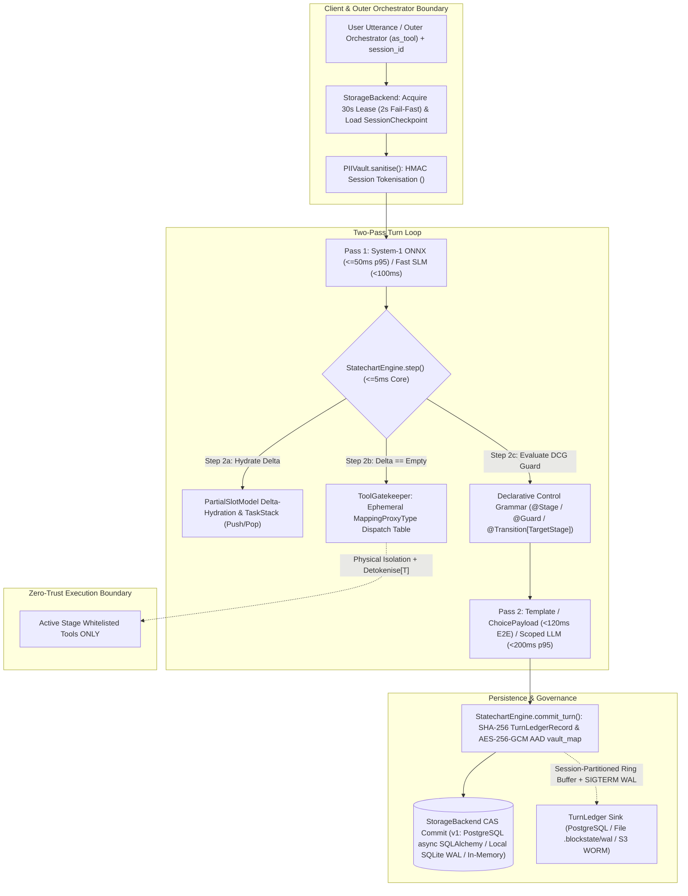
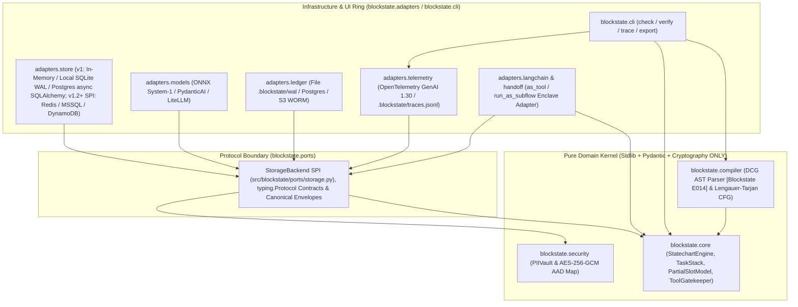
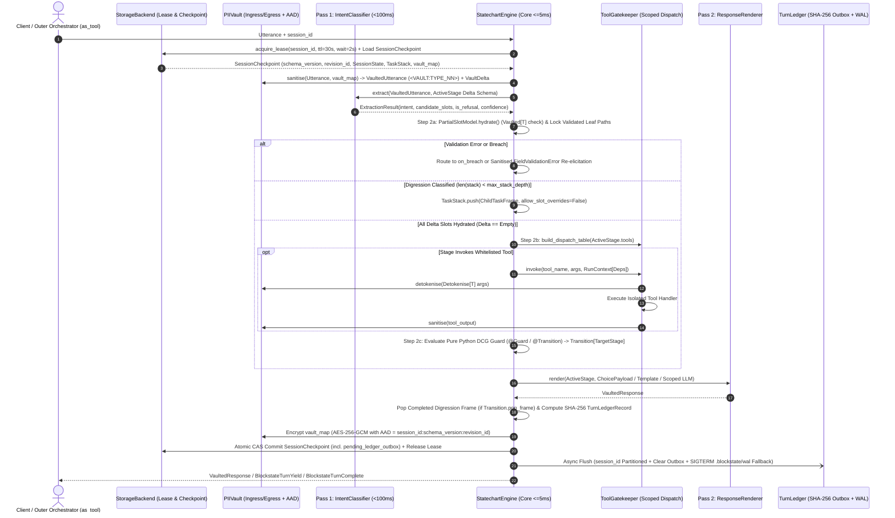
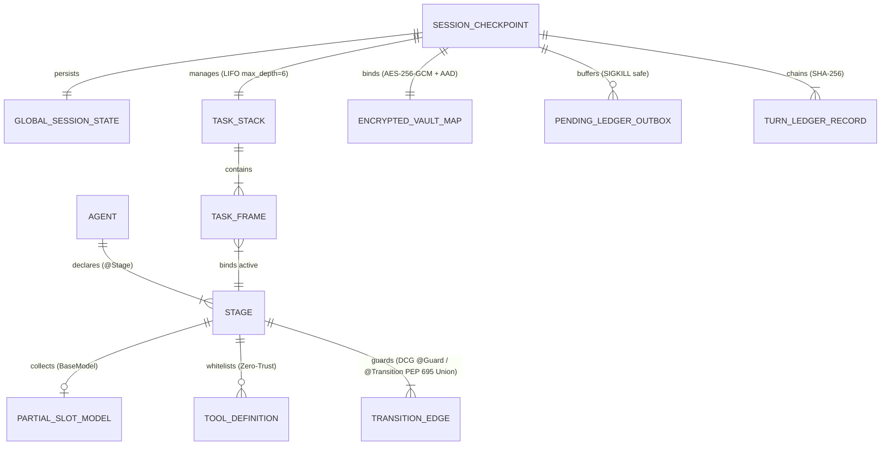
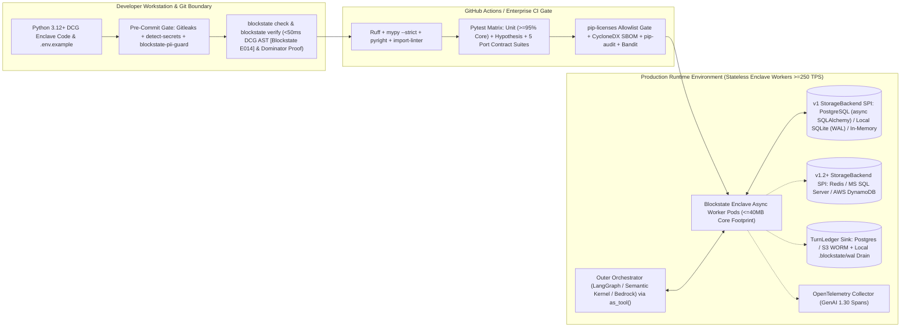

# Architecture Diagrams — Blockstate (`blockstate`)

Visual topology, sequence, entity-relationship, and CI/CD operational diagrams referenced by `SPEC.md` and `ARCHITECTURE-SPINE.md`.

## 1. Two-Pass Turn Loop & Zero-Trust Execution Boundary

## 2. Hexagonal Package Architecture (`AD-1`)

## 3. Runtime Execution & Two-Pass Zero-Trust Sequence (`AD-6`, `AD-7`, `AD-8`, `AD-9`)

## 4. Core Domain Entity Relationships

## 5. Operational, CI/CD & Deployment Envelope (`AD-11`, `AD-12`, `AD-13`)

