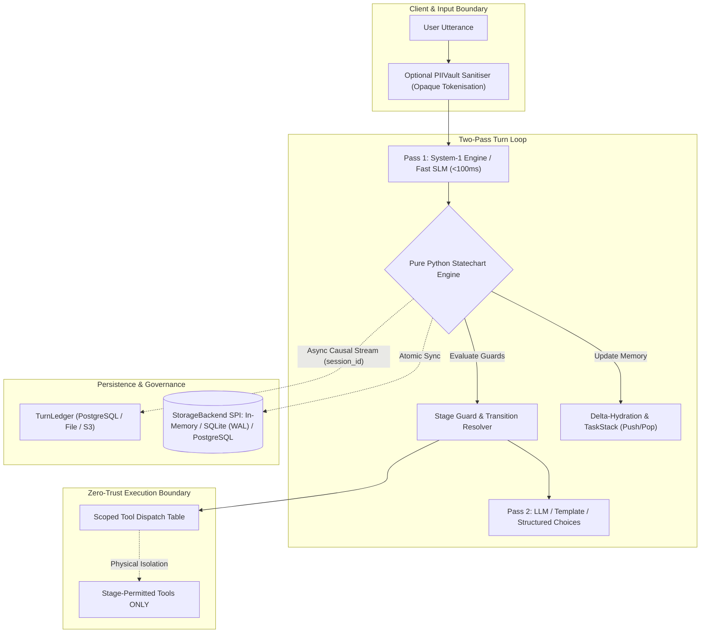

# PRD: Blockstate (`blockstate`)
*Deterministic statecharts and zero-trust tool gating for LLMs.*

---

## 0. Document Purpose

This Product Requirements Document (PRD) establishes the architectural specification, functional boundaries, and governance standards for **Blockstate** (PyPI: `blockstate`, CLI: `blockstate`; derived from railway *absolute block signalling* combined with deterministic *state machines*), an enterprise Python framework designed to bring mathematical determinism, zero-trust security, and compile-time verification to production Large Language Model (LLM) agent systems.

This document serves AI platform engineers, backend systems architects, compliance/risk officers, and downstream implementation teams. It synthesises requirements established during foundational threat modelling and naming sessions ([`forged-idea.md`](file:///e:/Development/railroad/_bmad-output/forge/railroad-agent-governance/forged-idea.md)), competitive gap analysis against LangGraph, NVIDIA NeMo Guardrails, LlamaIndex Workflows, and Pydantic-Graph ([`addendum.md`](file:///e:/Development/railroad/_bmad-output/planning-artifacts/prds/prd-railroad-2026-10-27/addendum.md)), and formal quality and reconciliation reviews ([`review-rubric.md`](file:///e:/Development/railroad/_bmad-output/planning-artifacts/prds/prd-railroad-2026-10-27/review-rubric.md), [`reconcile-forged-idea.md`](file:///e:/Development/railroad/_bmad-output/planning-artifacts/prds/prd-railroad-2026-10-27/reconcile-forged-idea.md), [`reconcile-amendments.md`](file:///e:/Development/railroad/_bmad-output/planning-artifacts/prds/prd-railroad-2026-10-27/reconcile-amendments.md)).

Requirements are formulated around a strictly enforced Glossary (§3), globally stable numbered identifiers (`FR-1` through `FR-22`, `SM-1` through `SM-7`), and bidirectional inline `[ASSUMPTION]` tags indexed in §9.

---

## 1. Vision

Modern agent frameworks (such as early LangChain, AutoGen, and CrewAI) operate on the ReAct (Reason + Act) loop, giving LLMs probabilistic autonomy to decide which tools to invoke, when to transition between workflow stages, and how to maintain state. While effective in open-domain exploratory environments, this non-deterministic model has led to catastrophic failure modes in **regulated enterprise domains** (banking, healthcare, insurance, and telecommunications). In these industries, regulatory mandates (such as EU AI Act Article 12, UK FCA operational rules, and HIPAA) make autonomous tool execution and unverified execution sequencing an unacceptable corporate liability.

**Blockstate fundamentally inverts the control hierarchy: the LLM is never the orchestrator.**

Blockstate is **"FastAPI meets XState for Regulated AI"**. The deterministic Python runtime owns 100% of state transitions, guard conditions, and dispatch tables. The LLM is demoted to a constrained worker invoked strictly for bounded semantic extraction (slot-filling) and natural language rendering. By pairing a **Declarative Control Grammar (DCG)** (`@Stage`, `@Transition`, `@Guard`) with a static Python AST compiler, Blockstate bypasses Rice's Theorem to mathematically prove that compliance steps (e.g. Identity Verification / KYC) strictly dominate high-risk actions (e.g. Financial Disbursement) before a single line of code reaches production.

Crucially, Blockstate is positioned not as a rip-and-replace for high-level conversational orchestrators (such as LangGraph, Microsoft Semantic Kernel, AutoGen, or AWS Bedrock)—avoiding the **"Enterprise Island Trap"**—but as a **transactional compliance execution enclave**. Through a first-class `as_tool()` adapter, an outer conversational bot can brainstorm or handle open-ended dialogue in LangGraph, and the moment real money moves or regulated compliance data is collected, execution transitions seamlessly into the verified Blockstate enclave. Combined with zero-trust tool containment at the hardware memory boundary and an execution call stack (`TaskStack`) that absorbs multi-turn user digressions without combinatorial state-graph explosion, Blockstate provides the first industrial-grade foundation for mission-critical enterprise conversational AI.

---

## 2. Target User & Personas

### 2.1 Jobs To Be Done (JTBD)

- **Functional (Platform Engineer):** *"When I implement multi-turn conversational agents with Pydantic schemas, I want to declare deterministic state transitions in pure Python, so that the LLM cannot hallucinate illegal workflow steps or execute unapproved tools."* `[ASSUMPTION: §2.1]`
- **Functional (Compliance / MRM Officer):** *"When an AI application is submitted for regulatory audit, I want mathematical proof that mandatory verification stages cannot be bypassed under any prompt condition, so that I can authorise deployment under EU AI Act and FCA standards."*
- **Contextual / Operational (SRE / Backend Dev):** *"When a production agent encounters adversarial inputs, unexpected user digressions, or upstream model latency spikes, I want sub-100ms routing decisions, local zero-setup dev traces, and tamper-evident audit ledgers, so that our customer SLAs and data privacy covenants remain intact."*
- **Emotional (Engineering Leadership):** *"I want confidence that our customer-facing conversational agents will never make headlines for rogue tool execution, unauthorised refunds, or PII leakage."*

### 2.2 Non-Users (v1)

- **Open-Ended Research Agents:** Blockstate is explicitly not designed for autonomous web-crawling agents, exploratory coding copilots, or creative free-form ideation loops that require unbounded tool agency.
- **Low-Code / No-Code Prompt Builders:** Blockstate targets professional software engineers and AI platform teams writing typed Python code. Visual drag-and-drop workflow editing is out of scope for v1.

### 2.3 Key User Journeys

#### UJ-1: Dan builds a multi-turn motor insurance claim agent with tangents
- **Persona & Context:** Dan, Senior Backend Engineer at an enterprise insurer, building a self-service motor claims assistant.
- **Entry State:** Fresh Python 3.12+ service with `blockstate` and `pydantic` installed.
- **Path:** Dan defines `@Stage(name="incident_details", collect=IncidentSlots, allow_digressions=[PolicyFaqTool])`. He defines tier-based payout stages: `@Stage(name="auto_payout", tools=[DisburseFundsTool])` for claims under `£100`, and `@Stage(name="manager_review")` for claims above `£100`. In stage guards, he writes pure Python conditions ensuring payout stages only execute if identity is verified. During testing, the simulated user asks *"Will this claim affect my no-claims discount?"* right after submitting the vehicle registration. Blockstate pauses the active frame, pushes a `TaskFrame` for the FAQ, queries the read-only policy tool, pops the frame, and returns to collecting the date of the incident with the registration slot intact and uncorrupted.
- **Climax:** Dan executes an end-to-end simulated run; the claim collects all 6 required fields over 8 turns with zero custom edge routing boilerplate.
- **Resolution:** The agent passes all automated tests without state mutation bugs or dropped fields.
- **Edge Case:** The user inputs an incident date in the future. The Pydantic validator rejects it; Blockstate catches the validation error and immediately prompts the user to re-enter only the invalid field without clearing previously validated slots.

#### UJ-2: Sophia audits the compliance graph in CI/CD before deployment
- **Persona & Context:** Sophia, Model Risk Management (MRM) Officer at a UK retail bank.
- **Entry State:** Pull request submitted by the conversational banking team containing a new loan rescheduling agent with multiple tiered disbursement branches (`claim_under_100`, `claim_100_to_200`, `claim_over_200`).
- **Path:** Sophia runs `blockstate verify --dominates "verify_identity -> [claim_under_100, claim_100_to_200, claim_over_200]"` inside the CI pipeline. The command parses the Python AST, generates the Control Flow Graph (CFG), and runs the Lengauer-Tarjan dominator tree algorithm across all branch paths.
- **Climax:** The build succeeds, outputting a cryptographic assertion log and a verified Mermaid diagram proving that every path from graph entry to any disbursement stage passes through `verify_identity`.
- **Resolution:** Sophia attaches the generated audit artifact to the compliance approval ticket and signs off on production release.
- **Edge Case:** A junior developer added a backdoor bypass route for VIP test users. `blockstate verify` immediately fails the CI build, outputting the exact counter-example transition path: `Entry -> CheckVIP -> AutoPayout`.

#### UJ-3: Omar investigates a disputed customer interaction via TurnLedger & Local Traces
- **Persona & Context:** Omar, Production SRE on call for an enterprise customer portal.
- **Entry State:** Customer alleges that the agent promised an unauthorised credit refund.
- **Path:** Omar runs `blockstate trace --session <session_id>` on his local terminal or queries the `TurnLedger` stream. He inspects the immutable, hash-chained turn records rendered in a clear terminal timeline. For the turn in question, he inspects the exact whitelist of tools exposed (`exposed_tools`), the model prompt hash, the PII-vaulted input tokens, and the deterministic stage transition record.
- **Climax:** Omar proves via the cryptographically signed ledger that the agent was in `@Stage("account_overview")`, where `issue_credit` was physically absent from the dispatch table, and that the canned response adhered strictly to company policy.
- **Resolution:** Audit dispute resolved within 10 minutes with verifiable mathematical provenance.

---

## 3. Glossary

*All downstream artifacts, specifications, and codebase implementations must use these terms verbatim. Synonyms are strictly prohibited.*

- **Statechart:** A formal, deterministic finite-state machine supporting hierarchical states, entry/exit actions, declarative transitions, and stage guards, managed strictly by the Python runtime.
- **Declarative Control Grammar (DCG):** The statically decidable subset of Python's Abstract Syntax Tree (AST) enforced by `blockstate check`. Restricts statechart topology declarations to explicit declarative decorators (`@Stage`, `@Transition`, `@Guard`) and static state references, prohibiting dynamic reflection (`getattr`, `eval`, or computed transition targets) so that dominator proofs remain mathematically decidable under Rice's Theorem.
- **Stage:** An isolated conversational and operational state declared via `@Stage`. Defines permitted tools, target slot-collection models, permitted digressions, and optional turn allowances.
- **Stage Guard:** A deterministic Python predicate declared via `@Guard` or evaluated within a `@Transition` / `@Stage` return-type union that governs whether a transition to a static target Stage is permitted.
- **Tool Gating:** The physical scoping of tools such that unpermitted functions do not exist in the model's schema payload or the runtime dispatch table for that turn.
- **Dispatch Table:** The memory-isolated lookup dictionary mapping tool names to callable function pointers for the active turn.
- **Dominator Tree:** A tree representing dominator relationships in the statechart Control Flow Graph (CFG), where stage $D$ dominates stage $N$ ($D \text{ dom } N$) if every execution path from the root to $N$ must pass through $D$.
- **Static Graph Compiler:** The CLI inspection engine (`blockstate check` / `blockstate verify`) that parses Python ASTs under the Declarative Control Grammar (DCG) to extract statechart topology and verify safety properties without executing LLM code.
- **TaskFrame:** A discrete unit of execution context containing the active stage identifier, partially hydrated slots, turn counts, and frame-local metadata.
- **TaskStack:** A Last-In, First-Out (LIFO) call stack of `TaskFrame` objects managing multi-turn conversational detours and pushdown automata execution.
- **PartialSlotModel:** A dynamic metaclass wrapper derived from a Pydantic model that makes fields optional during intermediate multi-turn collection while enforcing strict field validators upon ingestion.
- **$\Delta$-Hydration:** The automated calculation of remaining uncollected slots:
  $$\Delta = \text{RequiredFields} \setminus \text{HydratedFields}$$
- **Two-Pass Turn Loop:** An execution pattern that splits each turn into Pass 1 (fast intent classification and slot extraction via System-1 decision engines or SLMs in $<100\text{ms}$) and Pass 2 (deterministic transition evaluation followed by natural language rendering, template dispatch, or structured choice menus).
- **TurnLedger:** An asynchronous, append-only, tamper-evident audit log that records state transitions, input hashes, exposed tools, and SHA-256 hash chains per conversational turn.
- **PIIVault:** A local, pluggable sanitisation boundary that maps detected PII to opaque deterministic session tokens (e.g. `<VAULT:POSTCODE_01>`) before passing context to LLMs.
- **StorageBackend SPI:** The formal asynchronous Service Provider Interface governing session state persistence and distributed lease management across canonical v1 backends (`In-Memory`, `Local SQLite (WAL)`, `PostgreSQL`) and v1.2+ plugin drivers.
- **Global SessionState:** Cross-cutting, verified facts (e.g. `user_id`, `auth_level`) persisted across the entire session, distinct from ephemeral task frame state.
- **Orchestrator Handoff Protocol:** Standardised enclave invocation interfaces (`as_tool()`, `blockstate.adapters.langchain.as_tool`, `run_as_subflow()`) allowing external high-level orchestrators (LangGraph, Microsoft Semantic Kernel, AutoGen, AWS Bedrock) to invoke Blockstate as a verified transactional compliance execution enclave and receive typed results upon completion.

---

## 4. Features & Functional Requirements



### 4.1 Deterministic Statechart Runtime & Stage Guards
**Description:** The core Python runtime governing agent execution under the **Declarative Control Grammar (DCG)**. Stages, transitions, and guards are declared explicitly via `@Stage`, `@Transition`, and `@Guard` decorators. The LLM is never permitted to determine state transitions autonomously; transitions occur solely via static state references and deterministic Python guard predicates evaluated against validated session data. `[ASSUMPTION: §4.1]` Realizes UJ-1.

#### FR-1: Declarative Stage Definition (`@Stage`)
The system must allow developers to declare conversational stages using the `@Stage` decorator specifying a unique string identifier, an optional Pydantic slot model, a list of allowed tools, an optional turn allowance (`max_turns`), and a list of permitted digressions. Realizes UJ-1.
- **Consequences (testable):**
  - Defining two stages with duplicate identifiers raises `DuplicateStageError` at application startup.
  - Attempting to declare a stage without a unique name raises `ConfigurationError`.
- **Out of Scope:** Dynamic runtime generation of novel stages not present in Python source code.

#### FR-2: Pure Python Stage Guards (`@Guard`, `@Transition`) & Validator Boundary
The system must evaluate stage transition conditions using declarative `@Guard` predicates, `@Transition` routing rules, and PEP 695 return-type annotations (`Transition[TargetStage]`), resolving next stages based strictly on validated data and static stage identifiers. Realizes UJ-1, UJ-2.
- **Consequences (testable):**
  - If a `@Guard` predicate evaluates to `False`, the runtime halts transition and remains in the active stage or routes to a declared fallback stage.
  - Prompt text emitted by an LLM cannot alter a transition target evaluated by a stage guard.
  - Embedding stage transition targets or routing logic inside Pydantic `@field_validator` methods is strictly prohibited and rejected by `blockstate check` to preserve static AST compilability.

#### FR-3: Optional Maximum Turn Enforcement & Circuit Breaking
The system must support an optional `max_turns` limit per stage (defaults to 5 if unspecified; setting `max_turns=None` or `<= 0` disables turn limits for open-ended administrative stages). If slot collection or task resolution exceeds `max_turns`, the runtime must trigger a deterministic fallback transition (e.g. human escalation or security lockout). Realizes UJ-1.
- **Consequences (testable):**
  - When `max_turns` is an integer and `turn_count > max_turns`, the runtime bypasses LLM generation and invokes `on_max_turns_exceeded`.
  - When `max_turns=None`, turn counts increment without triggering circuit breaking.
  - If an upstream model returns an AI safety refusal or unresolvable error, the runtime immediately short-circuits to the stage's declared `on_refusal` fallback handler rather than consuming ordinary conversational turns.

---

### 4.2 Zero-Trust Stage Tool Containment
**Description:** Enforces strict physical isolation of tools. Tools are defined per stage. During any given turn, unpermitted tools do not exist in the schema passed to the LLM, nor do they exist in the runtime dispatch table. Realizes UJ-1, UJ-3.

#### FR-4: Dynamic Schema Scoping
The system must generate the LLM tool-calling schema payload dynamically on each turn, containing exclusively the tools whitelisted in the active `@Stage`. Realizes UJ-1, UJ-3.
- **Consequences (testable):**
  - Inspecting the raw JSON payload passed to the model provider confirms that unlisted tools are completely omitted from the schema.

#### FR-5: Memory-Isolated Tool Dispatch Table
The system must resolve tool execution requests against a stage-scoped dispatch table. If an LLM emits a tool call for a tool not in the active stage's dispatch table, the runtime must reject execution immediately. Realizes UJ-3.
- **Consequences (testable):**
  - Emitting an unauthorised tool name raises `SecurityViolationError`, aborts tool execution, logs a critical event to `TurnLedger`, and transitions to a locked state.
  - No global tool registry or fallback tool runner is accessible during stage execution.

---

### 4.3 Declarative Slot-Filling, $\Delta$-Hydration & Validation Routing
**Description:** Automates multi-turn data collection into structured Pydantic models. Converts rigid schemas into progressive partial models, validating field-by-field and short-circuiting errors immediately. Supports early stage exits on disqualifying values and handles complex nested models recursively. Realizes UJ-1.

#### FR-6: Partial Model Transformation & Recursive Nested Ingestion
The system must automatically derive a partial collection model from any standard Pydantic model (`@Stage(collect=ClaimModel)`), allowing fields to be collected over multiple turns while retaining field-level type validation. Realizes UJ-1.
- **Nested Schema Support:** For models containing nested Pydantic children, `PartialSlotModel` must recursively convert required child fields to optional during intermediate turns, validating extracted child fields per turn without crashing on missing sibling fields, and only assembling the strict root model once all required child fields are hydrated.
- **Consequences (testable):**
  - Feeding a single valid field (e.g. `{"policy_number": "POL-123"}`) successfully updates the `TaskFrame` without failing on missing required fields.
  - Feeding an invalid type triggers immediate validation error capture without corrupting previously collected fields.

#### FR-7: Validation Error Short-Circuiting & Early Stage Routing
The system must compute the exact delta of unhydrated fields ($\Delta$) after each turn. If a field fails Pydantic validation, the runtime must isolate the error message and pass it to the response generator to elicit correction immediately. Furthermore, developers may declare early transition targets upon critical validation breaches (`on_breach=Transition.to("disqualified")`). Realizes UJ-1.
- **Consequences (testable):**
  - The agent does not prompt for subsequent fields until all previously supplied invalid fields are resolved.
  - When an `on_breach` transition target is triggered by a validation failure (e.g. ineligible age or vehicle type), slot collection halts immediately and the session transitions to the alternate stage before remaining slots are gathered.
  - Validated fields are locked and cannot be mutated unless an explicit revision intent or authorised re-entry route is classified.

---

### 4.4 Dialog Pushdown Automata & Context Stack (`TaskStack`)
**Description:** Manages multi-turn digressions, clarifications, and sub-flows via an execution call stack (`TaskStack`), eliminating the need to author $N \times M$ transition edges across states. Realizes UJ-1.

#### FR-8: TaskStack Push with Strict Slot Isolation
When an incoming utterance is classified as a permitted digression (e.g. policy FAQ or terms explanation), the system must push a child `TaskFrame` onto the `TaskStack`, preserving the parent frame's collected slots in read-only isolation. Realizes UJ-1.
- **Consequences (testable):**
  - `len(stack)` increases by 1.
  - The child frame executes with its own scoped tools (read-only retrieval).
  - Attempting to mutate parent frame slots from a child frame without explicit configuration raises `UnauthorisedMutationError`.

#### FR-9: TaskStack Pop and Explicit Slot Overrides
Upon resolution of the child task, the system must pop the child `TaskFrame` and resume the parent stage. If and only if the stage explicitly declares `allow_slot_overrides=True` or the child emits an authorised `SlotMutation` directive, parent or global slots may be updated; otherwise, parent slots remain strictly intact. Realizes UJ-1.
- **Consequences (testable):**
  - `len(stack)` decrements by 1.
  - Without `allow_slot_overrides=True`, parent slots after pop are identical to before push.

---

### 4.5 Static Graph Compiler & Dominator Proofs (`blockstate check`)
**Description:** A build-time command-line utility that inspects Python source files via AST parsing under the **Declarative Control Grammar (DCG)**, verifies graph integrity, and mathematically proves safety and compliance reachability invariants across complex branching pathways. `[ASSUMPTION: §4.5]` Realizes UJ-2.

#### FR-10: Declarative Control Grammar (DCG) & Python AST Graph Extraction
Because **Rice's Theorem** dictates that non-trivial semantic properties of arbitrary, unconstrained Python code are mathematically undecidable, the system must define and enforce a strict **Declarative Control Grammar (DCG)** over Python's `ast` module. The compiler must restrict statechart topology definitions to declarative decorators (`@Stage`, `@Transition`, `@Guard`) and static state references without executing user code or requiring network connectivity, extracting all stages, guards, tool bindings, and transitions into a directed graph. Realizes UJ-2.
- **Static Target Enforcement & Actionable Compiler Diagnostics:** If a developer writes dynamic reflection (e.g. `getattr(self, dynamic_state)()`), dynamic string interpolation, or variable-resolved transition targets inside a statechart method, the build pass must terminate immediately with an explicit compiler error:
  ```text
  [Blockstate E014] Dynamic transition destination detected at mortgage_flow.py:42.
  Transitions must reference static State definitions to enable Lengauer-Tarjan dominator verification.
  ```
- **Consequences (testable):**
  - Any dynamic transition destination or reflection call inside `@Stage`, `@Transition`, or `@Guard` fails `blockstate check` with exit code 1 and prints `[Blockstate E014]` with exact file name and line number.
  - Syntax errors or malformed transition declarations are reported with file name and line number.
  - Dead stages (unreachable from initial stage) are flagged as build warnings or errors.

#### FR-11: Mathematical Dominator Verification for Branching Workflows
The system must implement the Lengauer-Tarjan dominator tree algorithm to verify user-specified dominance assertions via CLI: `blockstate verify --dominates "<PrecursorStage> -> <ProtectedTarget(s)>"`. Realizes UJ-2.
- **Multi-Branching Support:** The compiler must verify dominance across multiple alternate pathways (e.g. verifying that `verify_identity` dominates all disbursement tiers: `claim_under_100`, `claim_100_to_200`, and `claim_over_200`).
- **Consequences (testable):**
  - If any execution path from root to any target bypasses the precursor stage, the command exits with code 1 and prints the exact violating path.
  - If the precursor stage dominates all targets, the command exits with code 0 and emits an audit certificate in JSON/Markdown.

#### FR-12: Mermaid & Schema Export
The system must export verified statecharts to Mermaid markdown format (`blockstate export --format mermaid`) and JSON schemas representing the agent's complete topology and stage tool boundaries. Realizes UJ-2.
- **Consequences (testable):**
  - Output generates valid Mermaid code fences displaying stage nodes, tool tags, and guard annotations.

---

### 4.6 Two-Pass Decoupled Latency Engine & Structured Choices
**Description:** High-performance turn architecture decoupling fast intent classification from natural language rendering to satisfy strict enterprise latency SLAs. Realizes UJ-1.

#### FR-13: Sub-100ms Pass 1 Routing with System-1 Engines & SLMs
The system must provide an abstract `IntentClassifier` interface supporting fast non-autoregressive decision models (e.g. text embeddings, Jev/TEV, ModernBERT ONNX, linear probe classifiers) and fast SLMs (e.g. Claude 3.5 Haiku, GPT-4o-mini, Groq Llama-3-8B) to extract intents and candidate slots in $<100\text{ms}$. Realizes UJ-1.
- **Consequences (testable):**
  - Local ONNX/ModernBERT System-1 classifiers achieve p95 extraction latency $\le 50\text{ms}$.

#### FR-14: Pass 2 Template Dispatch & Structured Choice Payloads
The system must support immediate template rendering for terminal or legally fixed disclosures, and structured multiple-choice payloads (`ChoicePayload`) for client-rendered selectable options (e.g. *"Did you want to discuss your current account or your credit card today?"*). Realizes UJ-1.
- **Consequences (testable):**
  - For stages configured with `canned_response` or `choice_options`, total turn execution time (Pass 1 + Python Logic + Template/Choice) executes in $<120\text{ms}$ end-to-end.

---

### 4.7 Cryptographic Turn Ledger & PII Vault
**Description:** Tamper-evident audit logging and tokenised PII boundary protection for regulatory compliance. `[ASSUMPTION: §4.7]` Realizes UJ-3.

#### FR-15: Tokenised PII Boundary (`PIIVault`)
The system must provide a pluggable `PIIStripper` protocol that detects and replaces sensitive identifiers (names, phone numbers, postcodes, national IDs) with deterministic opaque session tokens before transmission to LLMs. Realizes UJ-3.
- **Consequences (testable):**
  - Raw PII strings are absent from all outbound LLM prompts and message histories.
  - The runtime automatically de-tokenises arguments matching tool parameter schemas before invoking tool handlers; explicit programmatic de-tokenisation is available via `context.vault.detokenise()`.

#### FR-16: Tamper-Evident SHA-256 Hash Chaining
The system must log every turn as an immutable `TurnLedger` record containing the previous record's SHA-256 hash, creating a tamper-evident audit chain. Realizes UJ-3.
- **Consequences (testable):**
  - Modifying any byte in a historical turn record invalidates the cryptographic hash chain of all subsequent records.

#### FR-17: Asynchronous Session-Partitioned Ledger Emission
The system must emit `TurnLedger` records via an asynchronous queue strictly partitioned and keyed by `session_id`, guaranteeing monotonic causal ordering across distributed workers while preventing write I/O from blocking client turn latency. Realizes UJ-1, UJ-3.
- **Consequences (testable):**
  - Slow ledger write I/O does not degrade client turn latency.
  - Distributed writes for the same session are guaranteed sequential, preserving SHA-256 hash chain validity.

---

### 4.8 State Persistence & Multi-Instance Concurrency
**Description:** Distributed state storage and atomic locking ensuring safe concurrent execution across enterprise database environments via a formal `StorageBackend` Service Provider Interface (SPI). `[ASSUMPTION: §4.8]` Realizes UJ-1.

#### FR-18: Formal `StorageBackend` SPI & Version 1 Storage Slicing
To prevent connection pool maintenance, schema migrations, and concurrency lock semantics across five or more persistence engines from bogging down v1 engineering velocity, the system must define a formal async `StorageBackend` SPI with v1 sliced strictly to three canonical backends:
- **v1 Canonical Backends:**
  1. **In-Memory:** For hermetic unit testing and fast CI/CD pipeline execution.
  2. **Local SQLite with WAL (Write-Ahead Logging) mode:** For zero-dependency local development and single-node edge deployments.
  3. **PostgreSQL via async SQLAlchemy:** For high-concurrency cloud production workloads and JSONB ACID transactions.
- **v1.2+ Deferred Backends (via `StorageBackend` SPI):** **Redis**, **Microsoft SQL Server**, and **AWS DynamoDB** are explicitly deferred to v1.2+ (with Oracle Database and Azure Cosmos DB in v2+) as plug-in implementations of the `StorageBackend` SPI.
Realizes UJ-1.
- **Consequences (testable):**
  - Switching between In-Memory, Local SQLite (WAL), and PostgreSQL (async SQLAlchemy) or third-party `StorageBackend` SPI implementations requires zero changes to agent stage code.
  - Local SQLite automatically enables `PRAGMA journal_mode=WAL;` on connection initialisation.

#### FR-19: Distributed Session Locking & Concurrency Control
The system must acquire a distributed lease/lock per `session_id` before processing an incoming utterance, enforcing a fail-fast policy with a 2-second acquisition timeout (raising `ConcurrentSessionError` / HTTP 409 Conflict upon contention). Locks must default to a 30-second TTL with automated background heartbeats during active tool runs. Realizes UJ-1.
- **Consequences (testable):**
  - Two simultaneous requests for the same session cannot trigger concurrent state mutations or race conditions.
  - Stale locks from crashed worker processes are automatically released after 30 seconds.

---

### 4.9 Outer Orchestrator Integration, Tracing & Memory Contracts
**Description:** First-class enclave adapters enabling existing enterprise conversational orchestrators (LangGraph, Microsoft Semantic Kernel, AutoGen, AWS Bedrock) to invoke Blockstate as a verified transactional compliance execution enclave, paired with formal state scoping and developer observability tools. Realizes UJ-1, UJ-3.

#### FR-20: Outer Orchestrator Entrypoint (`as_tool()` Enclave Adapter)
To avoid the **"Enterprise Island Trap"**—where enterprises with heavy investments in LangGraph, Microsoft Semantic Kernel, AutoGen, or AWS Bedrock refuse to discard their existing conversational estate—Blockstate must position and expose itself as a **transactional compliance execution enclave** via a first-class `as_tool()` adapter (including dedicated framework adapters such as `from blockstate.adapters.langchain import as_tool`) and an async streaming generator `run_as_subflow()`. Realizes UJ-1.
- **Enclave Execution Boundary:** An outer conversational bot can brainstorm, answer general questions, or chit-chat in LangGraph, Semantic Kernel, AutoGen, or Bedrock, and the moment real money moves or regulated compliance data is collected, execution transitions into the verified Blockstate enclave (`langgraph_agent.bind_tools([as_tool(MortgageOriginationEnclave, name="execute_mortgage_transaction")])`).
- **Multi-Turn Yield/Resume Contract:** When Blockstate requires intermediate customer input (e.g. collecting next slot), `as_tool()` yields a typed `BlockstateTurnYield(session_id=..., message=..., state="in_progress")`. The outer orchestrator relays the message to the user and re-invokes Blockstate with `(session_id=..., user_message=...)`. Upon terminal transition, Blockstate returns `BlockstateTurnComplete(session_id=..., result=ValidatedModel, state="completed")`.
- **Consequences (testable):**
  - Outer orchestrators can bind an entire verified statechart as a single validated tool via `as_tool(MortgageOriginationEnclave, name="execute_mortgage_transaction")` or `MotorClaimAgent.as_tool()`.
  - While inside the Blockstate enclave, Blockstate's zero-trust tool gating and statechart rules strictly govern execution; upon terminal transition, control yields back cleanly with a validated Pydantic model.

#### FR-21: Local Session Trace & Terminal Replay (`blockstate trace`)
The system must provide an interactive CLI replay command (`blockstate trace --session <session_id> [--file <path>] [--format table|json]`) that reads from local JSONL logs (`.blockstate/traces.jsonl`) or configured `StorageBackend` implementations to render visual, turn-by-turn timelines of slot hydration, tool dispatch boundaries, and transition guard decisions. Realizes UJ-3.
- **Consequences (testable):**
  - Running `blockstate trace --session <id>` prints a Rich terminal table with turn numbers, input hashes, state transitions, and exposed tool boundaries.
  - Developers can debug multi-turn sessions locally without cloud database connectivity.

#### FR-22: Formal Two-Tier Memory Contract (`SessionState` vs `TaskFrameState`)
The system must enforce strict scoping between `Global SessionState` (cross-flow verified facts, read-only to child frames by default, persistent across the entire session) and `TaskFrameState` (ephemeral slot hydration, turn counts, and scoped execution metadata). Realizes UJ-1.
- **Consequences (testable):**
  - `Global SessionState` is persisted atomically alongside the active `TaskStack` in the configured `StorageBackend`.
  - Popping or discarding a child `TaskFrame` does not corrupt or wipe verified facts in `SessionState`.

---

## 5. Non-Goals (Explicit)

- **Autonomous Goal Seeking (No Unbounded ReAct Loops):** Blockstate will not support open-ended autonomous agents that dynamically invent their own goals or self-prompt in unconstrained loops. *(Note: Blockstate can be invoked by an outer router as a transactional compliance enclave, but Blockstate's internal execution is strictly deterministic).*
- **Full-Estate Conversational Orchestrator Replacement (Avoiding the "Enterprise Island Trap"):** Blockstate does not seek to rip-and-replace existing enterprise investments in high-level conversational orchestrators (LangGraph, Microsoft Semantic Kernel, AutoGen, or AWS Bedrock). Instead, it integrates as a verified transactional compliance execution enclave via `as_tool()`.
- **External Non-Python DSL Files:** Blockstate will not invent a separate non-Python domain-specific language file format (such as NVIDIA's `.co` Colang files). All agent configurations, schemas, and guards are written in standard, type-annotated Python governed at compile time by the **Declarative Control Grammar (DCG)** AST subset (`@Stage`, `@Transition`, `@Guard`).
- **Global Mandatory Confirmation Steps:** Blockstate will not enforce mandatory user confirmation steps before every action; confirmation dialogs are strictly stage-configurable where business logic requires them.
- **Transitions inside Pydantic Model Validators:** Blockstate will not support declaring stage transition targets inside `@field_validator` methods, as scattering transition targets outside the Declarative Control Grammar (`@Stage`, `@Transition`, `@Guard`) breaks static AST compilation and dominator verification.
- **Direct GUI Visual Builder in v1:** Blockstate v1 will not include a drag-and-drop web UI for constructing statecharts; visual workflows are represented via generated Mermaid diagrams, CLI trace tables, and OpenTelemetry spans.
- **Bespoke LLM Client Implementations:** Blockstate will not implement custom HTTP wrappers for individual model providers; it delegates LLM execution directly to **PydanticAI** and **LiteLLM**.
- **Retroactive Time-Travel Rewind DAGs (MVP):** Blockstate will not support automated time-travel execution rewinds that attempt to undo external API side effects; backtracking requires explicit forward-compensating stages.
- **Heavyweight Formal Policy Solvers:** Blockstate deliberately rejects heavyweight SMT/formal policy solvers (e.g. Z3, TLA+) in favour of fast, standard graph dominator algorithms (Lengauer-Tarjan) executable in $<50\text{ms}$ during standard CI/CD builds.

---

## 6. MVP Scope

### 6.1 In Scope (v1 MVP)
- Declarative Control Grammar (DCG) decorators (`@Stage`, `@Transition`, `@Guard`) and deterministic Python stage guard runtime with optional `max_turns`.
- Dynamic `PartialSlotModel` metaclass with Pydantic v2 validation, delta-hydration, early breach routing, and recursive nested model support.
- Zero-trust stage-scoped tool dispatch tables and prompt schema isolation.
- `TaskStack` dialog pushdown automata with strict default slot isolation and declared `allow_slot_overrides`.
- `blockstate` CLI with `check` (DCG AST validation & `[Blockstate E014]` static target enforcement), `verify` (Lengauer-Tarjan dominator tree analysis for single and multi-branch workflows), and `trace` (local terminal replay).
- Mermaid diagram export (`blockstate export --format mermaid`).
- Two-Pass turn loop supporting System-1 decision engines (ONNX / ModernBERT / TEV) and fast SLMs.
- Structured choice payloads (`ChoicePayload`) for client-rendered selectable options.
- Local zero-setup file logging (`.blockstate/traces.jsonl`) for developer debugging.
- Pluggable `PIIVault` regex/tokeniser protocol.
- Hash-chained `TurnLedger` with session-partitioned async emission to PostgreSQL, local files, and S3.
- Formal `StorageBackend` SPI with three canonical v1 backends: **In-Memory** (unit testing/CI), **Local SQLite with WAL mode** (local dev/edge), and **PostgreSQL via async SQLAlchemy** (cloud production).
- First-class Outer Orchestrator `as_tool()` Enclave Adapters (`from blockstate.adapters.langchain import as_tool`, `Agent.as_tool()`, `run_as_subflow()`).

### 6.2 Post-MVP Roadmap (`v1.1`, `v1.2+`, `v2.0+` — see [`docs/ROADMAP.md`](../ROADMAP.md))
- **v1.1 Code-First Visual Statechart Studio (`blockstate studio`) & CLI Scaffolder (`blockstate init`):** Interactive local web canvas that renders Python DCG statecharts, runs live `<5ms` Lengauer-Tarjan dominator verification with visual counterexample paths, simulates multi-turn `TaskStack` / `PIIVault` execution, and generates clean `.py` source files (Tier 1 in `v1.1`; bidirectional `libcst` surgical AST/CST sync as Tier 2 in `v1.2`), plus `blockstate init --template` project scaffolding.
- **v1.1 Extended Outer Orchestrator Enclave Adapters:** First-class `as_tool()` wrappers for **Microsoft Semantic Kernel**, **AutoGen**, and **AWS Bedrock Agents** alongside `blockstate.adapters.langchain`.
- **v1.2+ Deferred Storage Backends (via `StorageBackend` SPI) & Dialogue Repair Utilities:** **Redis** (`RedisStorageBackend`), **Microsoft SQL Server** (`MSSQLStorageBackend`), and **AWS DynamoDB** (`DynamoDBStorageBackend`), plus built-in Pass 2 `FieldValidationError` dialogue repair prompt builders.
- **v2.0+ Extended Enterprise Database Adapters:** Oracle Database and Azure Cosmos DB (deferred to v2.0).
- **v2.0+ Native Enterprise Message Bus Streaming:** AWS SQS, Apache Kafka, and Google Cloud Pub/Sub `LedgerSink` drivers for `TurnLedger` (PostgreSQL/S3/File ship in v1.0).
- **v2.0+ Automated Adversarial Conversation Fuzzer (`blockstate fuzz`) & Polyglot SDKs:** Synthetic multi-turn adversarial conversation and prompt-injection fuzzer (`blockstate fuzz`), plus TypeScript, Go, and Rust enclave SDKs.

---

## 7. Success Metrics & Quality Gates

*All metrics are cross-referenced against the functional requirements they validate.*

### 7.1 Primary Metrics
- **SM-1 (Mathematical Determinism):** 100% of state transitions in production are governed by deterministic Python guards; 0% probabilistic routing escapes. *Validates FR-1, FR-2.*
- **SM-2 (Zero Tool Leaks):** 0 incidents of unpermitted tool calls executed outside their active stage whitelist. *Validates FR-4, FR-5.*
- **SM-3 (CI Verification Coverage):** 100% of pull requests in regulated projects verify required dominator invariants across all branches via `blockstate verify` in $<2\text{s}$ compile time. *Validates FR-10, FR-11.*
- **SM-4 (Turn Latency SLA):** p95 turn latency $<200\text{ms}$ for System-1/SLM classified turns and $<120\text{ms}$ for canned disclosures or choice menus. *Validates FR-13, FR-14.*

### 7.2 Secondary Metrics
- **SM-5 (Developer Velocity):** Developers author a multi-slot stage with digression handling in $<50$ lines of standard Python code (a 75% boilerplate reduction compared to LangGraph). *Validates FR-1, FR-6, FR-8.*
- **SM-6 (Audit & Debugging Velocity):** SREs and developers replay and isolate production turn failures in $<5$ minutes using `blockstate trace` and verifiable cryptographic SHA-256 hash chains. *Validates FR-16, FR-21.*
- **SM-7 (Zero State Overwrites):** 0 lost fields or silent slot overwrites during multi-turn customer sessions. *Validates FR-6, FR-7, FR-8, FR-22.*

### 7.3 Counter-Metrics (Do Not Optimise)
- **SM-C1 (Conversational Breadth vs Safety):** Do not optimise for open-domain conversational flexibility at the expense of strict stage guards. If user input cannot be mapped to a valid transition or permitted digression, the system must fail safe (clarify or escalate), never guess.
- **SM-C2 (Compiler Execution Speed vs AST Depth):** Do not sacrifice thoroughness in AST parsing or dominator tree validation to shave milliseconds off `blockstate check`. Correctness of mathematical proofs is strictly prioritised over compilation speed.

---

## 8. Open Questions & Management Tensions

1. **`[OPEN-1]` Local ONNX & System-1 Bundling (Resolved):** Blockstate will package local classification models as an optional extra (`pip install blockstate[local]` / `pip install blockstate[system1]`), bundling ONNX Runtime and a compact pre-trained classification head for zero-network environments.
2. **`[OPEN-2]` Partial Slot Metaclass Nested Schemas (Resolved):** Explained in detail in §4.3 and §12.3. `PartialSlotModel` dynamically wraps child models recursively, allowing progressive hydration of nested structures across multiple conversational turns.
3. **`[OPEN-3]` OpenTelemetry Span Standardisation (Resolved):** Blockstate will natively adopt OpenTelemetry Semantic Conventions for Generative AI (GenAI 1.30) across all turn traces, state transitions, and tool calls.
4. **`[OPEN-4]` Version 1 Storage Slicing (Resolved):** To avoid the engineering and CI test-matrix drag of maintaining connection pools, schema migrations, and distributed concurrency locks across 5+ persistence backends in v1, storage is sliced to three canonical v1 backends: **In-Memory** (hermetic unit tests & CI/CD), **Local SQLite with WAL mode** (zero-dependency local dev & edge), and **PostgreSQL via async SQLAlchemy** (cloud production). **Redis**, **Microsoft SQL Server**, and **AWS DynamoDB** are formally deferred to v1.2+ behind the `StorageBackend` SPI.
5. **`[NOTE FOR PM: Model Refusal Circuit Breaker Thresholds]`:** How many repeated model safety refusals or extraction failures should trigger human escalation versus an inline conversational apology? (Defaulting to 1 refusal triggers immediate deterministic canned fallback).

---

## 9. Assumptions Index

- `[ASSUMPTION: §2.1]` Enterprise target audience values compile-time compliance guarantees and deterministic execution over conversational autonomy and unstructured reasoning.
- `[ASSUMPTION: §4.1]` Python 3.12+ is the mandatory baseline runtime to leverage PEP 695 type parameter syntax (`type X[T] = ...`), PEP 701, and enhanced AST nodes.
- `[ASSUMPTION: §4.5]` Enforcing the Declarative Control Grammar (DCG) AST subset (`@Stage`, `@Transition`, `@Guard`) sidesteps Rice's Theorem and guarantees 100% static decidability, enabling Lengauer-Tarjan dominator analysis across statecharts with up to 500 nodes in $<50\text{ms}$.
- `[ASSUMPTION: §4.7]` Opaque tokenisation (`<VAULT:KEY_ID>`) is sufficient to prevent PII leakage into third-party LLM inference logs while preserving prompt context.
- `[ASSUMPTION: §4.8]` Slicing v1 persistence to three canonical `StorageBackend` drivers (In-Memory, Local SQLite with WAL mode, and PostgreSQL via async SQLAlchemy)—while deferring Redis, Microsoft SQL Server, and AWS DynamoDB to v1.2+ via the `StorageBackend` SPI—maximises v1 engineering velocity while covering unit testing, local/edge development, and enterprise cloud production.

---

## 10. Cross-Cutting Non-Functional Requirements (NFRs)

### 10.1 Performance & Latency Budgets
- **Framework Overhead:** Blockstate core runtime execution overhead (guard evaluation, stack manipulation, dispatch table lookup) must be $\le 5\text{ms}$ per turn.
- **Memory Footprint:** The core runtime without models loaded must consume $\le 40\text{MB}$ of resident RAM per worker process.
- **Throughput:** A single Python worker instance using async I/O must handle $\ge 250$ concurrent turns per second on a standard 2 vCPU container.

### 10.2 Security & Isolation
- **No `eval()` or Dynamic Reflection (DCG Enforcement):** All transition resolutions, AST checks, and dispatch lookups must adhere strictly to the Declarative Control Grammar (`@Stage`, `@Transition`, `@Guard`); dynamic string code evaluation (`eval()`) or dynamic reflection (`getattr(self, dynamic_state)()`) is strictly prohibited and rejected at compile time with `[Blockstate E014]`.
- **Least Privilege Dispatch:** Tools must be executed within isolated function contexts; tool handlers have access only to explicitly injected dependencies (`RunContext[Deps]`).

### 10.3 Observability & Developer Tracing
- Native OpenTelemetry instrumentation adopting GenAI 1.30 semantic conventions.
- Structured JSON logging to `stdout` following 12-factor standards, plus local append-only dev trace files (`.blockstate/traces.jsonl`).
- Dedicated CLI command `blockstate trace --session <id>` displaying turn timelines, extracted slots, tool boundaries, and transition provenance.

---

## 11. Compliance & Regulatory Alignment

| Regulatory Framework | Article / Standard | Blockstate Mechanism & Guarantee |
| :--- | :--- | :--- |
| **EU AI Act** | Article 12 (Record-Keeping) | Immutable, hash-chained `TurnLedger` recording all prompts, outputs, state transitions, and tool boundaries. |
| **EU AI Act** | Article 14 (Human Oversight) | Deterministic `max_turns` circuit breakers and explicit human-escalation fallback stages. |
| **UK FCA** | SYSC 13.7 (Operational Risk) | Build-time `blockstate verify` proving compliance checkpoints cannot be bypassed across all branch tiers. |
| **HIPAA / GDPR** | Safe Harbor / Data Minimisation | `PIIVault` tokenisation preventing PHI/PII from reaching LLM provider logs or unencrypted memory stores. |
| **SOC 2 Type II** | Trust Services Criteria (Security & Audit) | Zero-trust stage-scoped tool dispatch tables preventing unauthorised system actions. |

---

## 12. Developer Experience (DX) & Public API Surface

### 12.1 Canonical Developer Example (Declarative Control Grammar: `@Stage`, `@Transition`, `@Guard`)
```python
from pydantic import BaseModel, Field
from blockstate import Agent, Stage, Transition, Guard, ChoicePayload

class ClaimSlots(BaseModel):
    policy_id: str = Field(description="Policy identifier e.g. POL-12345")
    incident_date: str = Field(description="Date of incident in YYYY-MM-DD")
    damage_amount: float = Field(description="Estimated damage amount in GBP")

class MotorClaimAgent(Agent):
    @Guard(name="is_not_suspicious")
    def check_account_standing(self) -> bool:
        return not self.session.is_suspicious

    @Stage(
        name="collect_details",
        collect=ClaimSlots,
        allow_digressions=["policy_faq"],
        allow_slot_overrides=False, # Strict parent slot protection
        max_turns=5
    )
    @Transition(target="escalate", unless="is_not_suspicious")
    @Transition(target="tier_auto_payout")
    @Transition(target="tier_manager_review")
    async def collect_details(self, slots: ClaimSlots) -> Transition["tier_auto_payout" | "tier_manager_review" | "escalate"]:
        if not self.check_account_standing():
            return Transition.to("escalate", reason="Flagged account")
        
        # Static branching based on value thresholds (verified by DCG AST compiler)
        if slots.damage_amount <= 100.0:
            return Transition.to("tier_auto_payout")
        return Transition.to("tier_manager_review")

    @Stage(
        name="tier_auto_payout",
        tools=["disburse_funds_direct"],
        terminal=True
    )
    async def tier_auto_payout(self) -> Transition[None]:
        await self.tools.disburse_funds_direct(self.session.user_id, self.slots.damage_amount)
        return Transition.end(message="Your claim under £100 has been approved and disbursed.")
```

### 12.2 Outer Orchestrator Entrypoint (`as_tool()` Enclave Adapter)
```python
from blockstate.adapters.langchain import as_tool
from my_regulated_workflows import MortgageOriginationEnclave

# Expose the entire formal statechart as a single validated tool to LangGraph.
# The outer conversational bot can brainstorm or chit-chat in LangGraph, but the
# moment real money moves or compliance data is collected, execution transitions
# into the verified Blockstate enclave.
langgraph_agent.bind_tools([
    as_tool(MortgageOriginationEnclave, name="execute_mortgage_transaction")
])
```

### 12.3 Partial Slot Metaclass: Nested Schema Example
```python
class Address(BaseModel):
    street: str
    city: str
    postcode: str

class Customer(BaseModel):
    name: str
    address: Address

# Standard Pydantic would fail if turn 1 only provided:
# {"name": "Alice", "address": {"postcode": "EC1A 1BB"}}
# because street and city are missing.
#
# Blockstate's PartialSlotModel recursively relaxes missing fields to None during
# transit while enforcing type validators on present fields, only materialising
# the strict Customer model when all nested fields are fully hydrated.
```

### 12.4 CLI Commands
- `blockstate check [path]`: Validate all agent classes, type annotations, and stage graphs.
- `blockstate verify --dominates "<PrecursorStage> -> <ProtectedStage(s)>"`: Verify that PrecursorStage mathematically dominates ProtectedStage(s) across all branches.
- `blockstate trace --session <session_id>`: Replay a session turn-by-turn in rich terminal tables.
- `blockstate export --format [mermaid|json]`: Export verified topology diagrams and schemas.
