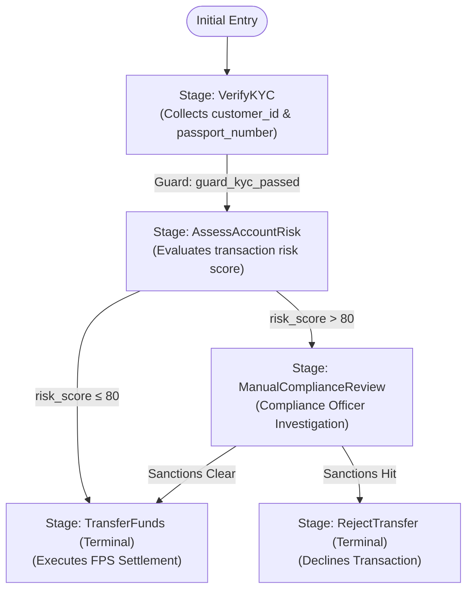
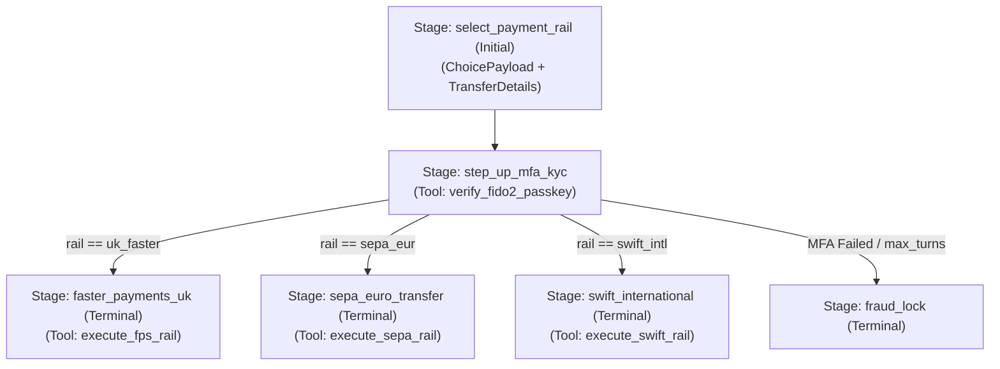
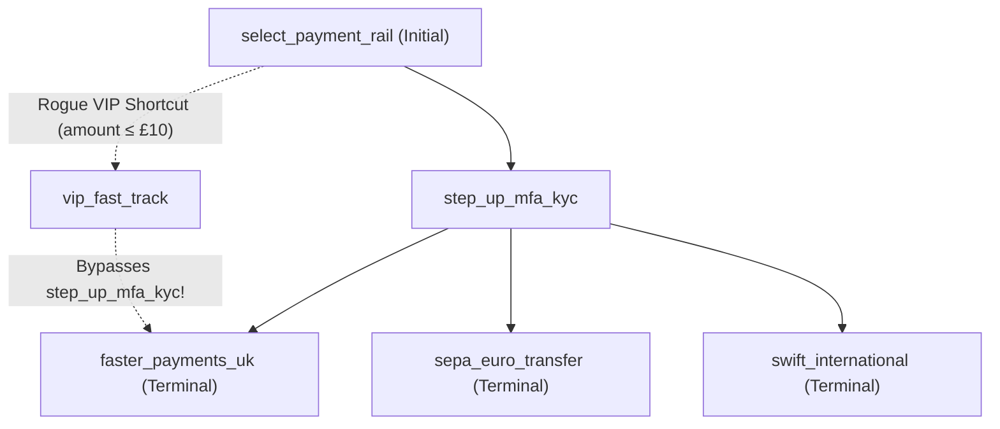

# Tutorial 2: Retail Banking KYC Dominator Proofs & CI Bypass Detection

In retail and commercial banking, payment execution workflows are governed by strict operational risk regulations including **UK FCA SYSC 13.7**, **Payment Services Regulations 2017 (Strong Customer Authentication)**, and **Bank of England PRA SS1/23 (Model Risk Management)**. Every domestic or international wire transfer must pass through Customer Due Diligence (KYC) and Multi-Factor Authentication (MFA) before settlement instructions reach an interbank clearing rail.

When conversational workflows grow to dozens of stages (handling fee disclosures, sanctions screening, manual compliance officer reviews, and multi-rail routing across UK Faster Payments, SEPA, and SWIFT), reviewing transition edges manually in pull requests becomes error-prone. A single shortcut transition introduced during a hotfix can create an unauthenticated bypass path from initial intake directly to payment execution.

Blockstate eliminates this class of vulnerability at compile time by combining the static **Declarative Control Grammar (DCG)** with the **Lengauer-Tarjan dominator tree algorithm** (`LengauerTarjanSolver`).

This tutorial walks through [`examples/02_banking_kyc_dominator.py`](../../examples/02_banking_kyc_dominator.py) and the multi-rail wire transfer topology, showing how Blockstate proves `VerifyKYC dom [TransferFunds]` and `step_up_mfa_kyc dom [faster_payments_uk, sepa_euro_transfer, swift_international]` in under 50 milliseconds, and how it catches a rogue VIP bypass edge in CI with a synthesised breadth-first counterexample path.

---

## 1. Control-Flow Topology & Precursor Dominance

In a directed control-flow graph $G = (V, E)$ with initial entry stage $r \in V$, a precursor stage $u \in V$ **dominates** a target stage $v \in V$ (written $u \text{ dom } v$) if every directed walk from $r$ to $v$ must contain $u$.

### 1.1 Reference Agent Topology (`02_banking_kyc_dominator.py`)

In [`examples/02_banking_kyc_dominator.py`](../../examples/02_banking_kyc_dominator.py), `BankingKYCDominatorAgent` enforces that `VerifyKYC` dominates `TransferFunds` across both the low-risk straight-through path and the high-risk `ManualComplianceReview` escalation path:



### 1.2 Multi-Rail Wire Transfer Topology (`step_up_mfa_kyc` Dominator)

In a multi-rail retail banking agent supporting UK Faster Payments (`faster_payments_uk`), SEPA Euro Transfers (`sepa_euro_transfer`), and SWIFT International Wires (`swift_international`), `step_up_mfa_kyc` acts as the single mandatory choke point between `select_payment_rail` and all three clearing rails:



---

## 2. Step-by-Step Code Walkthrough (`examples/02_banking_kyc_dominator.py`)

### Step 2.1: Declaring Typed Slot Schemas

The agent defines two Pydantic `BaseModel` schemas: `KYCSlots` for identity verification and `TransferSlots` for beneficiary payment instructions:

```python
from pydantic import BaseModel, Field


class KYCSlots(BaseModel):
    """Customer identity credentials required by banking regulations."""

    customer_id: str = Field(..., description="Unique customer banking identifier")
    passport_number: str = Field(..., description="Government-issued passport number")


class TransferSlots(BaseModel):
    """Financial transfer transaction instructions."""

    beneficiary_iban: str = Field(..., description="Destination beneficiary IBAN")
    amount_gbp: float = Field(..., description="Transfer amount in GBP")
```

### Step 2.2: Authoring the Statechart with `@Stage`, `@Guard`, and `@Transition`

Every stage and outgoing edge in `BankingKYCDominatorAgent` is declared using static decorators so that `StaticGraphCompiler` can extract the exact Control Flow Graph via `ast.parse` without executing bytecode:

```python
from typing import Any
from blockstate.core.agent import Agent, Guard, Stage, Transition


class BankingKYCDominatorAgent(Agent):
    """Regulated banking statechart enforcing mandatory KYC before fund transfer."""

    @Stage(
        name="VerifyKYC",
        collect=KYCSlots,
        canned_response="Please present your customer ID and passport number for KYC verification.",
    )
    @Transition(targets=["AssessAccountRisk"])
    def kyc_stage(self, slots: KYCSlots) -> Transition[str | None]:
        """Perform customer due diligence verification."""
        if slots.customer_id and slots.passport_number:
            return Transition.to("AssessAccountRisk")
        return Transition.stay()

    @Guard(stage="VerifyKYC", targets=["AssessAccountRisk"])
    def guard_kyc_passed(self, slots: KYCSlots | None) -> Transition[str | None]:
        """Deterministic guard verifying KYC credentials have been validated."""
        if slots is not None and slots.customer_id and slots.passport_number:
            return Transition.to("AssessAccountRisk")
        return Transition.stay()

    @Stage(
        name="AssessAccountRisk",
        canned_response="KYC verified. Please specify the beneficiary IBAN and amount to transfer.",
    )
    @Transition(targets=["TransferFunds", "ManualComplianceReview"])
    def risk_assessment_stage(self) -> Transition[str]:
        """Route standard transfers directly or escalate high-risk transactions."""
        risk_score = 10
        if risk_score > 80:
            return Transition.to("ManualComplianceReview")
        return Transition.to("TransferFunds")

    @Stage(
        name="ManualComplianceReview",
        canned_response="Your transfer has been flagged for enhanced compliance review.",
    )
    @Transition(targets=["TransferFunds", "RejectTransfer"])
    def review_stage(self) -> Transition[str]:
        """Officer review path that can either approve or reject."""
        is_sanctioned = False
        if is_sanctioned:
            return Transition.to("RejectTransfer")
        return Transition.to("TransferFunds")

    @Stage(
        name="TransferFunds",
        terminal=True,
        canned_response="Transfer successfully executed across the interbank clearing rail.",
    )
    def transfer_stage(self) -> Transition[dict[str, Any]]:
        """Terminal execution stage formalising money movement."""
        return Transition.end(
            result={
                "status": "settled",
                "rail": "FPS",
                "reference": "TXN-LON-77192",
            }
        )

    @Stage(
        name="RejectTransfer",
        terminal=True,
        canned_response="Transfer declined following compliance review.",
    )
    def reject_stage(self) -> Transition[dict[str, Any]]:
        """Terminal rejection stage."""
        return Transition.end(result={"status": "rejected"})
```

---

## 3. How `LengauerTarjanSolver` Proves Dominance in `< 50ms`

When you run `verify_dominance()` or `blockstate verify`, [`src/blockstate/compiler/dominators.py`](../../src/blockstate/compiler/dominators.py) executes four deterministic phases:

1. **Adjacency Extraction Including Fallback Edges**: `graph.adjacency_list(include_fallbacks=True)` collects all `@Transition` edges, `@Guard` edges, and fallback edges (`on_refusal`, `on_max_turns_exceeded`, `on_breach`, `on_security_violation`). Including fallback edges ensures that an exception or turn-limit escalation cannot accidentally route into a settlement stage without passing through KYC.
2. **Depth-First Search Numbering (`_dfs`)**: Computes pre-order depth-first search numbers (`dfnum[v]`) and parent links (`parent[v]`) from `root`.
3. **Semidominator & Immediate Dominator Computation (`solve`)**: Processes vertices in reverse DFS order using a disjoint-set forest with path compression (`_link`, `_eval`, `_compress`) to compute semidominators (`semi[w]`) and immediate dominators (`idom[w]`) in $\mathcal{O}(E \alpha(E, V))$ time.
4. **Dominator Set Verification**: Constructs `all_doms[target]` by walking up the `idom` chain from each target to `root` and verifies that `precursor in all_doms[target]`.

### Proving Multi-Rail Dominance Programmatically

```python
from blockstate.compiler.dominators import verify_dominance

multi_rail_graph = {
    "select_payment_rail": ["step_up_mfa_kyc"],
    "step_up_mfa_kyc": [
        "faster_payments_uk",
        "sepa_euro_transfer",
        "swift_international",
        "fraud_lock",
    ],
    "faster_payments_uk": [],
    "sepa_euro_transfer": [],
    "swift_international": [],
    "fraud_lock": [],
}

proof = verify_dominance(
    root="select_payment_rail",
    graph=multi_rail_graph,
    precursor="step_up_mfa_kyc",
    targets=["faster_payments_uk", "sepa_euro_transfer", "swift_international"],
)

assert proof.satisfied is True
print(proof.summary())
# Output:
# Dominance Verified: Precursor 'step_up_mfa_kyc' dominates all paths from root 'select_payment_rail'
# to target(s) [faster_payments_uk, sepa_euro_transfer, swift_international].
```

---

## 4. Catching a Rogue VIP Bypass Edge in CI with BFS Counterexample Synthesis

Suppose a developer modifies `select_payment_rail` in a pull request to add a "VIP low-value fast-track" shortcut that routes transfers under £10 directly from `select_payment_rail` to `faster_payments_uk` (or via a `vip_shortcut` stage), skipping `step_up_mfa_kyc`:



When `LengauerTarjanSolver` recomputes the dominator tree on this modified graph:
- Prior to the change, $\text{idom}(\text{faster\_payments\_uk}) = \text{step\_up\_mfa\_kyc}$.
- After the rogue edge is added, $\text{idom}(\text{faster\_payments\_uk})$ shifts upward to $\text{select\_payment\_rail}$, so `step_up_mfa_kyc` is no longer in `all_doms["faster_payments_uk"]`.

`verify_dominance()` immediately invokes `find_counterexample_path(root, graph, precursor, target)`, which removes `step_up_mfa_kyc` from the graph ($G \setminus \{\text{step\_up\_mfa\_kyc}\}$) and performs a breadth-first search from `select_payment_rail` to `faster_payments_uk` to find the shortest violating bypass path:

```python
rogue_graph = {
    "select_payment_rail": ["step_up_mfa_kyc", "vip_fast_track"],
    "vip_fast_track": ["faster_payments_uk"],  # Illegal bypass!
    "step_up_mfa_kyc": [
        "faster_payments_uk",
        "sepa_euro_transfer",
        "swift_international",
    ],
    "faster_payments_uk": [],
    "sepa_euro_transfer": [],
    "swift_international": [],
}

failed_proof = verify_dominance(
    root="select_payment_rail",
    graph=rogue_graph,
    precursor="step_up_mfa_kyc",
    targets=["faster_payments_uk", "sepa_euro_transfer", "swift_international"],
)

assert failed_proof.satisfied is False
assert failed_proof.violating_target == "faster_payments_uk"
assert failed_proof.violating_path == (
    "select_payment_rail",
    "vip_fast_track",
    "faster_payments_uk",
)
print(failed_proof.summary())
# Output:
# Dominance Violation: Precursor 'step_up_mfa_kyc' does not dominate target 'faster_payments_uk'.
# Violating bypass path: select_payment_rail -> vip_fast_track -> faster_payments_uk
```

In CI/CD, running `blockstate verify` blocks the pull request with exit code `1` and prints the exact violating route.

---

## 5. Running the Reference Agent & CLI Verification

Execute the complete reference script and CLI checks from the repository root:

```powershell
# 1. Run static AST check on the banking KYC agent
.\.venv\Scripts\python.exe -m blockstate.cli.main check examples/02_banking_kyc_dominator.py

# 2. Prove mathematical dominance via the CLI
.\.venv\Scripts\python.exe -m blockstate.cli.main verify examples/02_banking_kyc_dominator.py --dominates "VerifyKYC -> TransferFunds"

# 3. Run the multi-turn banking KYC simulation
.\.venv\Scripts\python.exe examples/02_banking_kyc_dominator.py
```

Expected output from `examples/02_banking_kyc_dominator.py`:

```text
--- Running Banking KYC Dominator Reference Agent ---
Dominance Proof: Dominance Verified: Precursor 'VerifyKYC' dominates all paths from root 'VerifyKYC' to target(s) [TransferFunds].
Turn 1 State: in_progress | Message: KYC verified. Please specify the beneficiary IBAN and amount to transfer.
Turn 2 State: completed | Result: {'status': 'settled', 'rail': 'FPS', 'reference': 'TXN-LON-77192'}
--- Banking KYC Dominator Reference Agent Completed Successfully ---
```
