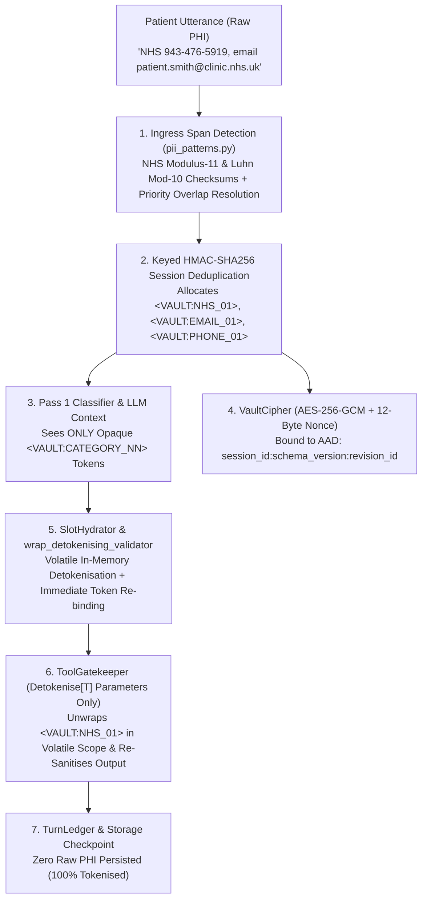

# Tutorial 3: Healthcare HIPAA & NHS `PIIVault` Tokenisation

Healthcare triage and clinical intake systems handle Protected Health Information (PHI) and special-category personal data governed by **HIPAA Safe Harbor**, **UK GDPR Article 9**, and the **NHS Caldicott Principles**. When a patient contacts a clinical triage assistant and provides their 10-digit NHS Number, US Social Security Number, payment card, telephone number, email address, or postcode, raw identifiers must never be sent to external commercial LLM APIs, persisted in unencrypted session checkpoints, or written to OpenTelemetry trace logs.

At the same time, downstream clinical validators and internal Electronic Health Record (EHR) scheduling tools require access to the real underlying identifier in volatile memory to verify check digits or query internal hospital databases.

Blockstate solves this through the **`PIIVault`** architecture ([`src/blockstate/security/vault.py`](../../src/blockstate/security/vault.py)), combining deterministic ingress checksum detection, keyed `HMAC-SHA256` session deduplication, `AES-256-GCM` authenticated encryption with AAD session binding, volatile-memory validator detokenisation (`wrap_detokenising_validator`), and selective `Detokenise[T]` tool parameter unwrapping.

This tutorial walks through [`examples/03_healthcare_hipaa_vault.py`](../../examples/03_healthcare_hipaa_vault.py) step by step.

---

## 1. Zero-Trust PHI Dataflow Architecture



---

## 2. Deterministic Ingress Tokenisation & Checksum Validation

Before any user message reaches Pass 1 (`IntentClassifier`) or session state, `PIIVault.sanitise()` scans the utterance using [`src/blockstate/security/pii_patterns.py`](../../src/blockstate/security/pii_patterns.py).

### 2.1 Mathematical Checksum Detectors (NHS Modulus-11 & Luhn Mod-10)

Rather than relying solely on naive regular expressions that produce false positives on arbitrary 10-digit or 16-digit numbers, Blockstate enforces mathematical checksum validation at ingress:

1. **UK NHS Number (`validate_nhs_mod11`)**:
   - Multiplies each of the first 9 digits by descending weights from `10` down to `2`:
     $$S = \sum_{i=0}^{8} d_i \times (10 - i)$$
   - Computes the remainder $R = S \bmod 11$ and check digit $C = 11 - R$ (where $C = 11$ maps to `0`, and $C = 10$ is rejected as invalid).
   - Accepts the span as `NHS` only if $C = d_9$ (for example, `943-476-5919` passes Modulus-11 validation).
2. **Payment Card Numbers (`validate_luhn`)**:
   - Validates 13-to-19 digit candidate spans using the standard Luhn modulo-10 algorithm, doubling every second digit from right to left and verifying that the sum is a multiple of `10`.
3. **Additional Structured Detectors**:
   - UK National Insurance Numbers (`NINO`), US Social Security Numbers (`SSN` with area/group/serial rules), email addresses (`EMAIL`), UK/US/international telephone numbers (`PHONE`), and UK/US postal codes (`POSTCODE`).

### 2.2 Longest-Span & Priority-Rank Overlap Resolution

When two candidate patterns overlap in the same text, `detect_pii_spans()` resolves conflicts deterministically:
1. Pre-existing `<VAULT:...>` tokens in the utterance are marked as protected spans and are never mutated or re-tokenised (`VAULT_TOKEN_PATTERN`).
2. Candidate matches are sorted by **longest span length descending**, then by **`CATEGORY_PRIORITY` ascending** (`EMAIL: 10`, `CARD: 20`, `NHS: 30`, `NINO: 40`, `SSN: 50`, `PHONE: 60`, `POSTCODE: 70`), and finally by start index.

### 2.3 Keyed `HMAC-SHA256` Session Deduplication

For each accepted span, `PIIVault` computes a keyed `HMAC-SHA256` digest using the configured secret pepper (`BLOCKSTATE_VAULT_PEPPER`):

```python
digest = hmac.new(
    self._pepper,
    f"{session_id}:{category}:{plaintext}".encode(),
    hashlib.sha256,
).hexdigest()
```

If the patient repeats the same NHS number or postcode in Turn 4 that they provided in Turn 1, `PIIVault` resolves the identical `HMAC-SHA256` digest and assigns the exact same session token (`<VAULT:NHS_01>`), preserving referential equality across turns without exposing the plaintext.

---

## 3. `AES-256-GCM` Vault Encryption with AAD Session Binding

When a session checkpoint is persisted to `StorageBackend` (SQLite WAL or PostgreSQL), the token-to-plaintext mapping (`vault_map`) is encrypted by `VaultCipher` ([`src/blockstate/security/vault.py`](../../src/blockstate/security/vault.py)):

- **Cipher**: `AES-256-GCM` using a 32-byte key (`BLOCKSTATE_VAULT_KEY`) and a fresh 12-byte cryptographic random nonce (`os.urandom(12)`) per encryption call.
- **Associated Authenticated Data (AAD)**: Every encrypted vault payload is cryptographically bound to the colon-separated session metadata string:
  ```text
  {session_id}:{schema_version}:{revision_id}
  ```
- **Tamper & Replay Rejection (`BLK-SEC-001`)**: If an attacker attempts to splice an encrypted `vault_map` from one session into another `session_id`, or roll back `revision_id` to an older turn, `AESGCM.decrypt()` fails tag verification and raises `SecurityViolationError` (`BLK-SEC-001`). `VaultCipher` also supports zero-downtime key rotation via `fallback_keys`.

---

## 4. Volatile-Memory Validator Detokenisation (`wrap_detokenising_validator`)

Suppose a Pydantic slot model declares a `@field_validator` on a `Vaulted[str]` field (for example, checking that a patient's NHS number or postcode belongs to an active catchment region). Because Pass 1 extracts the opaque token `<VAULT:NHS_01>`, running a custom validator directly on the literal string `"<VAULT:NHS_01>"` would fail.

In [`src/blockstate/core/slots.py`](../../src/blockstate/core/slots.py), `PartialSlotMetaclass` automatically wraps every `mode="after"` field validator using `wrap_detokenising_validator()`:

1. **Volatile Unwrapping**: Inside the `active_vault_context(vault, vault_map)` scope during `SlotHydrator.hydrate()`, `wrap_detokenising_validator` detokenises `<VAULT:NHS_01>` into `"943-476-5919"` strictly in local stack memory and passes the cleartext value to the validator function.
2. **Immediate Token Re-Binding**: As soon as the validator returns without error, the wrapper discards the cleartext reference and returns the original `<VAULT:NHS_01>` token so that `hydrated_slots` and `TaskFrame.slots` store only the opaque token.
3. **Exception PII Scrubbing**: If the validator raises a `ValueError` whose message echoes the cleartext value, `_sanitise_error_message()` replaces the plaintext back with `<VAULT:NHS_01>` (and scrubs any residual PII spans to `[REDACTED_PII]`) before constructing `FieldValidationError` (`BLK-VAL-002`).

---

## 5. Selective `Detokenise[T]` Tool Unwrapping (`examples/03_healthcare_hipaa_vault.py`)

In [`examples/03_healthcare_hipaa_vault.py`](../../examples/03_healthcare_hipaa_vault.py), `PatientIntakeSlots` marks sensitive fields with `Vaulted[str]`, while `schedule_clinical_triage` requests cleartext only for `national_id` via `Detokenise[str]`:

```python
from typing import Any
from pydantic import BaseModel, Field
from blockstate.core.agent import Agent, Guard, Stage, Transition
from blockstate.security.annotations import Detokenise, Vaulted


class PatientIntakeSlots(BaseModel):
    """Protected patient registration data containing vaulted PHI fields."""

    national_id: Vaulted[str] = Field(..., description="Government health identifier (NHS/SSN)")
    contact_email: Vaulted[str] = Field(..., description="Patient contact email address")
    contact_phone: Vaulted[str] = Field(..., description="Patient primary telephone contact")
    symptoms: str = Field(..., description="Reported clinical symptoms for triage")


def schedule_clinical_triage(
    national_id: Detokenise[str],
    contact_email: str,
    contact_phone: str,
    symptoms: str,
) -> dict[str, str]:
    """Authorised internal clinical tool receiving detokenised identifiers strictly in-memory."""
    # Inside this function:
    # - national_id is unwrapped to "943-476-5919" (because of Detokenise[str])
    # - contact_email remains "<VAULT:EMAIL_01>" (plain str annotation)
    # - contact_phone remains "<VAULT:PHONE_01>" (plain str annotation)
    return {
        "status": "confirmed",
        "triage_priority": "urgent" if "chest" in symptoms.lower() else "routine",
        "appointment_id": "APT-NHS-90124",
    }


schedule_clinical_triage._blockstate_tool = True
```

When `ToolGatekeeper.invoke()` executes `schedule_clinical_triage`:
1. It inspects the function's type annotations and unwraps only parameters annotated with `Detokenise[T]`.
2. Unannotated parameters (`contact_email: str`, `contact_phone: str`) remain tokenised even inside the tool.
3. If the tool's return value contains any raw PII strings or mappings, `ToolGatekeeper` automatically runs `vault.sanitise()` / `vault.sanitise_mapping()` on the tool output before returning it to the engine.

---

## 6. Running the Healthcare HIPAA Vault Example

Execute the reference agent and inspect the resulting trace log from the repository root:

```powershell
# 1. Run the Healthcare HIPAA Vault simulation
.\.venv\Scripts\python.exe examples/03_healthcare_hipaa_vault.py

# 2. Replay the cryptographic turn trace and verify zero PHI leakage
.\.venv\Scripts\python.exe -m blockstate.cli.main trace --session hipaa_session_9901
```

Expected output from `examples/03_healthcare_hipaa_vault.py`:

```text
--- Running Healthcare HIPAA Vault Reference Agent ---
Turn 1 State: completed | Result: {'status': 'scheduled', 'national_id_token': '<VAULT:NHS_01>', 'email_token': '<VAULT:EMAIL_01>', 'phone_token': '<VAULT:PHONE_01>', 'triage_id': 'TRG-LON-5512'}
Verification: Zero raw PHI strings detected in storage slots.
--- Healthcare HIPAA Vault Reference Agent Completed Successfully ---
```
