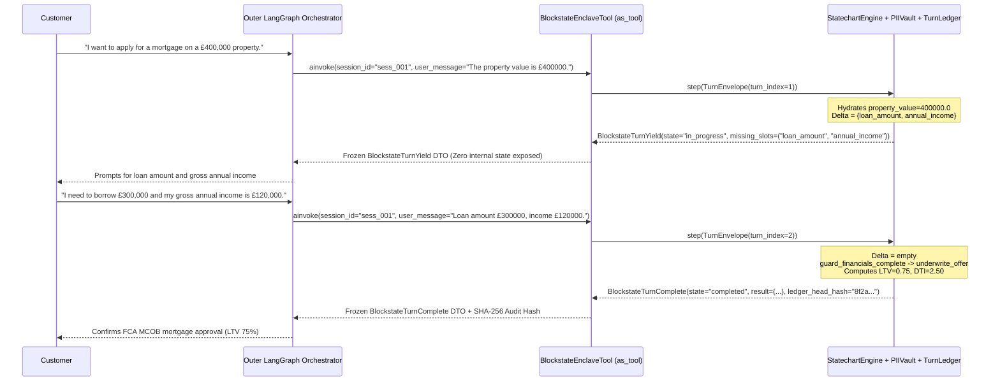

# Tutorial 4: Mounting a Blockstate Enclave Inside LangGraph (`as_tool()`)

Enterprise AI architectures frequently use a high-level orchestrator (such as **LangGraph**, **Microsoft Semantic Kernel**, **AutoGen**, or **AWS Bedrock Agents**) as an open-domain concierge router covering general customer queries, document search, and account navigation.

However, when a customer conversation enters a regulated boundary (such as originating a residential mortgage under **UK FCA MCOB**, executing a wire transfer, or filing an insurance claim), allowing a probabilistic outer router to orchestrate multi-turn compliance state and invoke privileged tools directly introduces severe compliance risk. Conversely, replacing the entire enterprise router with a rigid state machine creates an "Enterprise Island" that is difficult to integrate with existing agent graphs.

Blockstate resolves this architectural boundary by operating as a **Transactional Compliance Execution Enclave** ([`src/blockstate/adapters/langchain.py`](../../src/blockstate/adapters/langchain.py)). Using `as_tool()` or `run_as_subflow()`, you mount an entire verified Blockstate statechart as a single LangChain/LangGraph-compatible tool (`BlockstateEnclaveTool`) that communicates across a strict, frozen 3-state wire boundary (`BlockstateTurnYield`, `BlockstateTurnComplete`, `BlockstateTurnAborted`).

This tutorial walks through [`examples/04_langchain_subflow_handoff.py`](../../examples/04_langchain_subflow_handoff.py) step by step.

---

## 1. Enclave Wire Boundary Architecture



---

## 2. The Frozen 3-State Wire Protocol (`blockstate.ports.wire`)

To prevent outer orchestrators from mutating internal `TaskStack` frames, bypassing `@Guard` predicates, or invoking stage-scoped tools directly, [`BlockstateEnclaveTool`](../../src/blockstate/adapters/langchain.py) accepts strictly `EnclaveToolInput`:

```python
class EnclaveToolInput(BaseModel):
    model_config = ConfigDict(extra="forbid")

    session_id: str = Field(default="default_session")
    user_message: str = Field(default="")
    initial_context: dict[str, Any] | None = Field(default=None)
```

Every call to `ainvoke()`, `invoke()`, `arun()`, or `run_as_subflow()` returns exclusively one member of the frozen discriminated union defined in [`src/blockstate/ports/wire.py`](../../src/blockstate/ports/wire.py):

| Wire DTO Class | `state` Discriminator | Key Fields | Meaning & Outer Router Action |
| :--- | :--- | :--- | :--- |
| `BlockstateTurnYield` | `"in_progress"` | `session_id: str`<br/>`message: str`<br/>`choices: Sequence[...] \| None`<br/>`missing_slots: Sequence[str]` | The enclave is mid-workflow collecting missing slots ($\Delta \neq \emptyset$) or answering a `TaskStack` digression. Relay `message` (and optional `choices`) to the user and route their next reply back to the enclave tool with the same `session_id`. |
| `BlockstateTurnComplete[T]` | `"completed"` | `session_id: str`<br/>`result: T`<br/>`ledger_head_hash: str` | The enclave reached a `@Stage(terminal=True)` node. Control returns to the outer orchestrator with the validated `result` payload and the `RFC 8785 JCS` `SHA-256` `ledger_head_hash` proving non-repudiation across all turns. |
| `BlockstateTurnAborted` | `"aborted"` | `session_id: str`<br/>`error_code: str`<br/>`reason: str` | Execution halted due to a security boundary violation (`BLK-SEC-001..003`), lease contention (`BLK-CON-409`), or unhandled circuit breaker. Route to a human specialist or error handler. |

---

## 3. Step-by-Step Code Walkthrough (`examples/04_langchain_subflow_handoff.py`)

### Step 3.1: Define the Regulated Mortgage Enclave (`MortgageOriginationEnclave`)

In [`examples/04_langchain_subflow_handoff.py`](../../examples/04_langchain_subflow_handoff.py), `MortgageOriginationEnclave` collects `MortgageSlots` (`property_value`, `loan_amount`, `annual_income`) in `intake_financials` and transitions to `underwrite_offer` only when `guard_financials_complete` verifies that all three figures are strictly positive:

```python
from typing import Any
from pydantic import BaseModel, Field
from blockstate.core.agent import Agent, Guard, Stage, Transition


class MortgageSlots(BaseModel):
    """Financial parameters required for regulated mortgage affordability origination."""

    property_value: float = Field(..., description="Estimated market valuation of the property")
    loan_amount: float = Field(..., description="Requested borrowing principal amount")
    annual_income: float = Field(..., description="Gross verifiable annual applicant income")


class MortgageOriginationEnclave(Agent):
    """Regulated mortgage lending statechart executed as a compliance enclave."""

    @Stage(
        name="intake_financials",
        collect=MortgageSlots,
        canned_response=(
            "Please state property valuation, requested borrowing amount, and gross annual income."
        ),
    )
    @Transition(targets=["underwrite_offer"])
    def intake_stage(self, slots: MortgageSlots) -> Transition[str]:
        """Collect applicant financial metrics."""
        return Transition.to("underwrite_offer")

    @Guard(stage="intake_financials", targets=["underwrite_offer"])
    def guard_financials_complete(self, slots: MortgageSlots | None) -> Transition[str | None]:
        """Deterministic guard verifying all underwriting inputs are present."""
        if (
            slots is not None
            and slots.property_value > 0
            and slots.loan_amount > 0
            and slots.annual_income > 0
        ):
            return Transition.to("underwrite_offer")
        return Transition.stay()

    @Stage(
        name="underwrite_offer",
        terminal=True,
        canned_response="Mortgage underwriting assessment completed.",
    )
    def underwriting_stage(self, slots: MortgageSlots) -> Transition[dict[str, Any]]:
        """Terminal underwriting stage evaluating loan-to-value (LTV) and debt-to-income."""
        ltv = slots.loan_amount / slots.property_value
        dti = slots.loan_amount / slots.annual_income
        approved = ltv <= 0.85 and dti <= 4.5

        return Transition.end(
            result={
                "decision": "approved" if approved else "declined",
                "ltv_ratio": round(ltv, 4),
                "dti_ratio": round(dti, 4),
                "approved_principal": slots.loan_amount if approved else 0.0,
                "regulatory_disclosure": "FCA MCOB compliant deterministic assessment",
            }
        )
```

Notice that Loan-to-Value (`ltv <= 0.85`) and Debt-to-Income (`dti <= 4.5`) underwriting calculations are executed in pure deterministic Python inside `underwriting_stage`, never delegated to LLM arithmetic.

### Step 3.2: Mount the Enclave with `as_tool()`

Use `as_tool()` to wrap `MortgageOriginationEnclave` into a `BlockstateEnclaveTool` instance:

```python
from blockstate.adapters.langchain import as_tool

mortgage_tool = as_tool(
    MortgageOriginationEnclave,
    name="execute_mortgage_transaction",
    classifier=classifier,
)
```

When binding to a LangGraph or LangChain agent node, pass `mortgage_tool` in the tool list (`llm.bind_tools([mortgage_tool])`). You can also inject a production `SQLiteStorageBackend` or `PostgresStorageBackend` via the `storage=` keyword argument so enclave checkpoints persist across distributed gateway pods.

### Step 3.3: Multi-Turn Handoff & Pattern Matching in an Outer Router

Here is how an outer LangGraph node or API gateway drives the enclave across multiple turns using structural pattern matching:

```python
from blockstate.ports.wire import (
    BlockstateTurnAborted,
    BlockstateTurnComplete,
    BlockstateTurnYield,
)

session_id = "mortgage_enclave_sess_001"

# Turn 1: User supplies only the property valuation (£400,000)
turn1_outcome = await mortgage_tool.ainvoke(
    {
        "session_id": session_id,
        "user_message": "The property value is £400000.",
    }
)

match turn1_outcome:
    case BlockstateTurnYield(message=msg, missing_slots=missing):
        # missing == ('loan_amount', 'annual_income')
        print(f"Enclave yielding for slots {missing}: {msg}")

# Turn 2: User supplies the remaining loan amount (£300,000) and income (£120,000)
turn2_outcome = await mortgage_tool.ainvoke(
    {
        "session_id": session_id,
        "user_message": "Requested loan amount £300000 with gross annual income £120000.",
    }
)

match turn2_outcome:
    case BlockstateTurnComplete(result=decision_payload, ledger_head_hash=audit_hash):
        print(f"Underwriting Decision: {decision_payload['decision']}")
        print(f"LTV Ratio: {decision_payload['ltv_ratio']} | DTI Ratio: {decision_payload['dti_ratio']}")
        print(f"SHA-256 Ledger Head Hash: {audit_hash}")
    case BlockstateTurnAborted(error_code=code, reason=reason):
        print(f"Enclave aborted [{code}]: {reason}")
```

For single-call subflow execution without keeping a tool reference, you can also invoke `run_as_subflow(MortgageOriginationEnclave, session_id=..., user_message=...)` directly.

---

## 4. Running the LangGraph Enclave Handoff Example

Verify the enclave topology and run the multi-turn handoff simulation from the repository root:

```powershell
# 1. Verify the mortgage enclave AST and stage reachability
.\.venv\Scripts\python.exe -m blockstate.cli.main check examples/04_langchain_subflow_handoff.py

# 2. Prove that intake_financials strictly dominates underwrite_offer
.\.venv\Scripts\python.exe -m blockstate.cli.main verify examples/04_langchain_subflow_handoff.py --dominates "intake_financials -> underwrite_offer"

# 3. Execute the multi-turn LangGraph enclave handoff simulation
.\.venv\Scripts\python.exe examples/04_langchain_subflow_handoff.py
```

Expected output:

```text
--- Running LangChain/LangGraph Subflow Enclave Reference Agent ---
Mounted Tool Name: execute_mortgage_transaction
Tool Argument Schema: dict_keys(['session_id', 'user_message', 'initial_context'])

[Outer Orchestrator] Invoking enclave tool (Turn 1 - Partial Details)...
Enclave Response State: in_progress
Yielded Message: Please state property valuation, requested borrowing amount, and gross annual income.
Missing Required Slots: ('loan_amount', 'annual_income')

[Outer Orchestrator] Invoking enclave tool (Turn 2 - Complete Financials)...
Enclave Response State: completed
Final Decision: {'decision': 'approved', 'ltv_ratio': 0.75, 'dti_ratio': 2.5, 'approved_principal': 300000.0, 'regulatory_disclosure': 'FCA MCOB compliant deterministic assessment'}

[Outer Orchestrator] Testing run_as_subflow helper...
Subflow Result: approved (LTV: 0.7)

--- LangChain/LangGraph Subflow Enclave Reference Agent Completed Successfully ---
```
